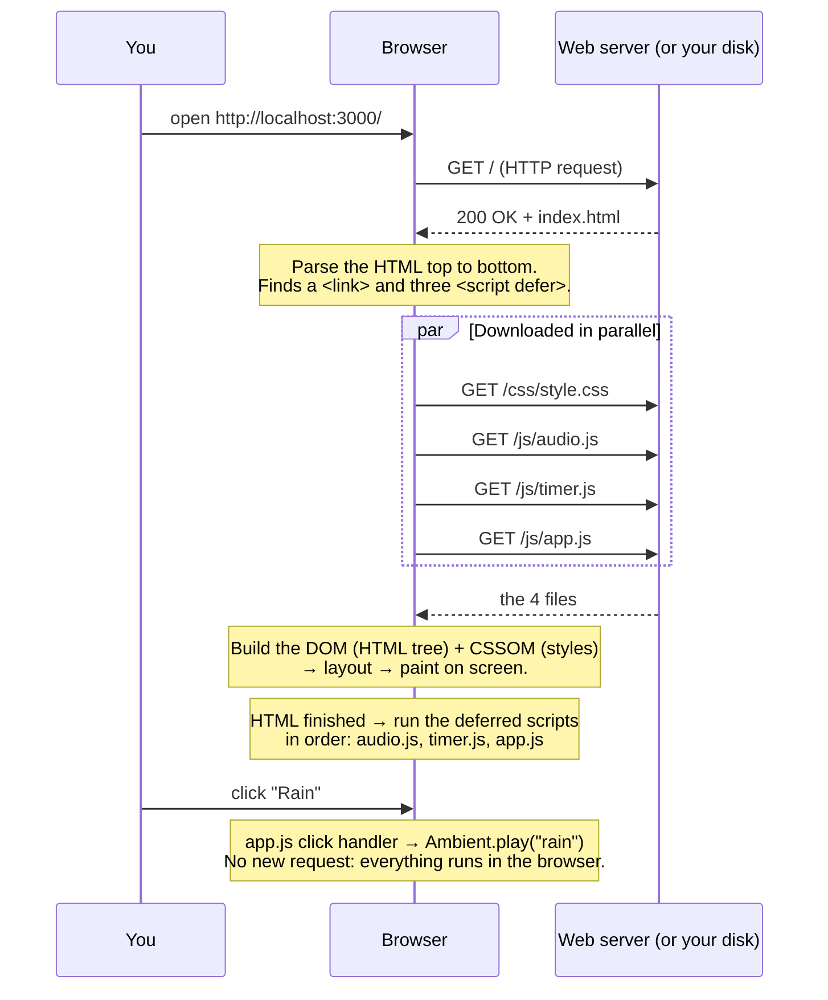
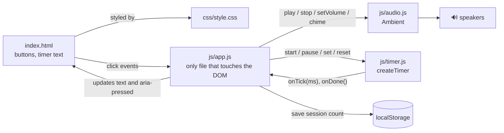

# Stage 1 — Static page: how a browser gets and shows Chill Corner

> The Stage 1 files now live in [`stage-1-static/`](../stage-1-static). Open `stage-1-static/index.html` to try it.

**Goal:** understand what happens between "open the page" and "the timer counts down".
There is no server code yet. The server (or your disk) only hands out files.

## 1. The request flow



Try it yourself: open DevTools (F12) → **Network** tab → reload.
You will see exactly 5 requests: the HTML, the CSS and the 3 scripts.
Clicking buttons adds **no** new requests: after loading, the page lives fully in the browser.

## 2. How the parts connect



The key idea: **`audio.js` and `timer.js` know nothing about the page.**
Only `app.js` reads buttons and changes text. This "separation of concerns" is the
same idea you will use later between the frontend, the API and the database.

## 3. The code that connects the parts

**HTML → JavaScript.** The page loads scripts with `defer`, so they run after the HTML exists, in order:

```html
<script src="js/audio.js" defer></script>
<script src="js/timer.js" defer></script>
<script src="js/app.js" defer></script>
```

**A click → a sound.** `app.js` finds the buttons and listens for clicks
(`data-track="rain"` in the HTML becomes `button.dataset.track` in JS):

```js
button.addEventListener("click", () => {
  const name = button.dataset.track;          // "rain"
  if (Ambient.playing() === name) Ambient.stop();
  else Ambient.play(name);
  updateTrackButtons();                        // aria-pressed → CSS turns it purple
});
```

**JavaScript → CSS.** JS never sets colours. It only changes an attribute,
and CSS decides how that looks:

```css
.track[aria-pressed="true"] { background: var(--primary); }
```

**Timer → page.** The timer calls back into `app.js`, which updates the text:

```js
const timer = createTimer({
  onTick(ms) { timeEl.textContent = format(ms); },
  onDone()   { Ambient.chime(); },
});
```

**Sound graph.** Web Audio connects nodes like cables between music gear:

```
noise source → highpass filter → lowpass filter → volume → master volume → speakers
```

## 4. Things worth noticing

- **Mobile-first CSS:** base styles are for phones; `@media (min-width: 720px)` puts the two cards side by side.
- **Accessibility:** real `<button>`s (keyboard works), `aria-pressed` for toggles, a skip link, visible focus outlines.
- **Accurate timer:** it stores the end time (`endAt`) instead of counting ticks, so a slow background tab doesn't drift.
- **Audio needs a click first:** browsers block sound until the user interacts, so the `AudioContext` is created on the first click.
- **localStorage** keeps today's focus session count in your browser only — no server involved yet.

## 5. Next: Stage 2

Stage 2 rebuilds this as a **Next.js + React + TypeScript** app.
Then the server no longer just hands out files: it can render pages before sending them.
