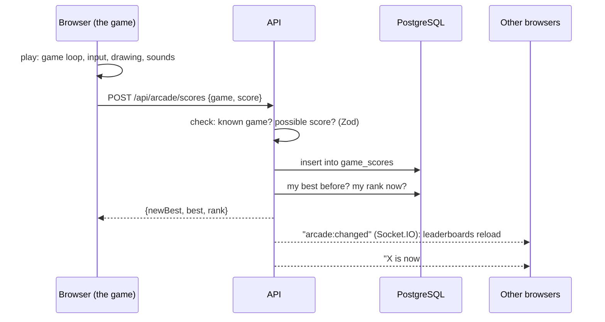

# Stage 10 — Games in the browser: the Mini Arcade (and a better music player)

**Goal:** learn how browser games work (a game loop, drawing on a `<canvas>`, keyboard and touch input,
sound made in code), and how a server keeps **high scores** that everyone shares, live.

Also in this stage, the **music player** got the controls people expect: volume, repeat, shuffle and a queue.

## 1. Mini Arcade: six silly games

Open **/arcade**. Every game works with a mouse, a keyboard or a finger, and saves your score to Nook.

| Game | What you do | Score | Built with |
|---|---|---|---|
| 🐛 **Hungry Worm** | steer a worm to snacks; chillies are double points | points (higher is better) | `<canvas>` + game loop |
| 🦆 **Silly Pairs** | find 8 pairs of animals | moves (lower is better) | buttons + CSS 3D flip |
| 🤪 **Bonk-a-Blob** | bonk blobs in 30 s, never the cat | points | buttons + a 100 ms tick |
| 🥞 **Pancake Tower** | drop sliding pancakes; overhangs fall off | pancakes | `<canvas>` + a scrolling "camera" |
| 🐢 **Too Early!** | tap when it turns green, 5 rounds | average ms (lower is better) | `performance.now()` |
| 🙃 **Odd Emoji Out** | find the one different emoji in 60 s | finds | a growing CSS grid |



### The game loop

Hungry Worm and Pancake Tower redraw a `<canvas>` about 60 times a second with `requestAnimationFrame`.
Each frame, the time since the last frame moves the game on, so it runs at the same speed on a slow phone
and a fast PC:

```ts
const frame = (now) => {
  acc += now - last;                       // time since the last frame
  while (acc >= tickMs(eaten)) { step(); acc -= tickMs(eaten); }   // the rules: one cell per tick
  draw(ctx, state);                        // the picture
  requestAnimationFrame(frame);
};
```

- The game's state lives in a **ref**, not React state: it changes 60 times a second, and re-rendering React
  that often would be slow. Only the score shown above the board is React state.
- The **rules** are plain functions with no drawing (`web/features/arcade/logic/*.ts`), so tests check them
  directly: "the worm grows when it eats", "the overhang falls off", "every animal is dealt twice".
- **Input:** keys (arrows, WASD, Space) with `preventDefault()` so the page doesn't scroll; **swipes**
  (pointer down → pointer up, the longer direction wins); and big buttons for phones.
- **Sounds** are made in code with the Web Audio API (`sfx.ts`): an oscillator plays a tone that slides and
  fades. No sound files to download. Browsers only allow sound after a tap, so the first sound comes from Play.
- **Code splitting:** each game is loaded only when you open it (`next/dynamic`), so the lobby stays small.

### High scores and leaderboards

One table, `game_scores`: one row per finished game, owned by your account or your guest browser (like focus
sessions). Guest scores move into your account when you sign up or log in.

The leaderboard takes **each person's best** with one SQL query: `max(score)` for points, `min(score)` for
games where lower is better (`api/src/arcade/games.ts` says which):

```sql
select coalesce('user:' || user_id, 'client:' || client_id) as who, max(score) as best
from game_scores where game = 'worm' and created_at >= now() - interval '7 days'
group by who order by best desc limit 10
```

| Endpoint | What |
|---|---|
| `GET /api/arcade/scores/:game?period=week\|all` | top 10, my best and my rank |
| `GET /api/arcade/me` | my best in every game (the lobby) |
| `POST /api/arcade/scores` | save a finished game (30 a minute per person) |

**Honest limit:** the browser sends the score, so someone who opens DevTools can send a fake one. The API
refuses impossible numbers (an unknown game, 1,000,000 points, 3 moves for 8 pairs), but that stops mistakes,
not cheaters. Real anti-cheat means the **server runs the game** and only trusts the players' moves: that's
the plan for **Arcade Online**.

## 2. A better music player

| Before | Now |
|---|---|
| Play, pause, next, previous | + **shuffle**, **repeat** (off → whole queue → this song) and **volume / mute** |
| The queue was hidden | **Up next** list: tap a song to jump to it, ✕ to remove it; **add to queue** from the charts |
| Always looped back to the first song | Stops after the last song unless repeat is on; **Previous** restarts the song after 3 s |
| A big card on phones | A **slim bar** on phones (play, next, progress line); the arrow opens the full player |

- Volume, repeat and shuffle are remembered in this browser (localStorage).
- **iPhones and iPads** don't let websites change the volume: the slider is replaced by "Use your device's
  volume buttons" there. Mute still works.
- The queue rules are plain functions (`web/features/music/queue.ts`) with their own tests.

## 3. Also fixed

- `OLLAMA_URL=` (empty), which the docs give as the way to turn the AI off, made the API refuse to start.
  Empty now means "AI off", as intended.
- On phones the tab bar shows **Arcade**, and game pages hide the big app header so the board fits on screen.

## 4. Tests

- API: saving scores, new bests for "higher" and "lower" games, impossible scores refused, leaderboard order
  and ranks, "this week" vs all time, guest scores moving into an account (`api/tests/arcade.test.ts`).
- Web: the rules of all six games (`web/tests/arcade-logic.test.ts`) and the music queue (`web/tests/music-queue.test.ts`).
- Played in Chromium on desktop and an emulated iPhone 13. **Not tested:** real phones (touch feel, iOS
  volume, sound), and how fun the games are. Please play them and tell me what to tune.

## Files

```
api/src/arcade/games.ts            the games' score rules (higher/lower, limits)
api/src/routes/arcade.ts           scores and leaderboards
api/drizzle/0008_arcade_scores.sql the game_scores table
web/app/arcade/                    lobby, /arcade/[game], /arcade/scores
web/features/arcade/               GameShell (start / game over / leaderboard), Leaderboard, Lobby, sfx
web/features/arcade/games/         the six games
web/features/arcade/logic/         their rules, without drawing (tested)
web/features/music/queue.ts        repeat / shuffle / queue rules (tested)
web/features/music/MusicDock.tsx   the player
```
