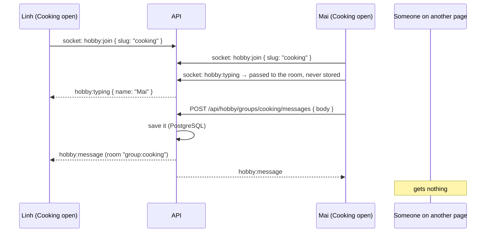

# Stage 11 — Community: Hobby Hub, names instead of accounts, keeping data only for a while

**Goal:** let people on the same Nook talk to each other, and learn how communities are built: groups, posts,
comments, likes and a live chat. Also: decide **what to store about people, and for how long**.

## 1. Names instead of accounts

Before, you could create an account with an email and password. On a home network everyone knows each other,
so that was more than needed. Now:

- The first time you open Nook, it asks **"What should we call you?"**. That's all: no email, no password.
- Names are unique (ignoring upper/lower case), so "Linh" and "linh" can't both exist.
- Nook remembers you **on that browser** with a cookie. Another phone, or clearing the browser's data,
  means picking a name again (the old one is freed when it's cleaned up, see below).
- **You** (`/account`) shows your name (change it any time), what Nook keeps about you, and **Delete me**.
- What you did before picking a name (focus history, scores, songs) becomes yours when you pick it.

```mermaid
sequenceDiagram
    participant B as Browser
    participant A as API
    participant P as PostgreSQL
    B->>A: POST /api/me { name: "Linh" }
    A->>P: insert into users (name) — refused if the name is taken (unique index on lower(name))
    A->>P: insert into auth_sessions (sha256 of a random token)
    A-->>B: 201 + Set-Cookie: nook_session=<token>; HttpOnly; SameSite=Lax
    B->>A: every later request carries the cookie
    A->>P: who has this token's hash? → Linh (cached 60 s in Valkey)
```

**Is it safe without a password?** Whoever has the cookie *is* you. The cookie never leaves the browser it was
made on (`HttpOnly`: page JavaScript can't read it; `SameSite=Lax`: other websites can't use it). The database
only has a hash of it. What a password would add is "log in on another device", which you chose not to need.
Someone *can* pick a name that looks like yours ("Linh." vs "Linh"); on a home network that's a human problem,
not a technical one.

**Is it right to store people in the database?** Yes: others need to see your name next to your posts and
scores, and your history must survive a restart. The rule is to keep **only what's needed, only as long as
it's needed**, and let people see and delete it. That's the rest of this stage.

## 2. What Nook stores

Everything is in **your PC's** PostgreSQL and Valkey. Nothing is sent to other companies (the AI runs on your PC too).

| Where | What | Kept |
|---|---|---|
| `users` | your name, settings (timer lengths), when you were last seen | until you delete yourself, or 90 days unused |
| `auth_sessions` | a **hash** of your browser's cookie, the browser's name (user agent), expiry | 90 days, renewed while you use Nook |
| `focus_sessions`, `achievements` | each focus session (mode, minutes, time), badges | with you |
| `game_scores` | each finished arcade game (game, score, time) | with you |
| `songs` + the song files | title, artist, genre, licence, credit, who added it | for everyone; "added by" is removed if you're deleted |
| `song_plays`, `song_likes` | which songs you played (once per 10 min) and liked, for the charts | with you |
| `hobby_groups`, `group_members` | groups, who joined which | with the group / with you |
| `posts`, `post_comments`, `post_likes` | what you wrote and liked in Hobby Hub | with you |
| `chat_messages` | Hobby Hub chat | **30 days** |
| `tips`, `knowledge` | the focus tips, and the AI's "meaning numbers" (embeddings) for tips and songs | always (not about people) |
| Valkey | 60-second cache, rate-limit counters (≤ 1 hour), the job queue, the last 20 live-feed events | minutes to hours |
| Your browser | guest id, theme, music volume, arcade sound on/off, the cookie | until you clear it |

**Not stored:** your email or a password (gone), the Free-time Companion conversations, "typing…", who's online.
Guests (no name yet) are stored by a random browser id; those rows are deleted after 90 days too.

## 3. Keeping data only for a while

`api/src/jobs/cleanup.ts` runs in the worker **once a day** (a BullMQ *job scheduler*, kept in Valkey, so with
several workers it still runs once in total):

| Rule | Setting in `.env` | Default |
|---|---|---|
| People not seen for this long are deleted, with everything they made | `DATA_RETENTION_DAYS` | 90 |
| Hobby Hub chat messages older than this are deleted | `CHAT_RETENTION_DAYS` | 30 |
| Guest rows (no name) older than `DATA_RETENTION_DAYS` are deleted | | |
| Expired sessions are deleted | | |

"Last seen" moves forward when you use Nook (at most once an hour, to spare the database). Deleting a person is
one `DELETE FROM users`: every table that points at `users` says **`on delete cascade`**, so PostgreSQL removes
their sessions, history, scores, posts, comments, likes and messages in the same step.

## 4. Hobby Hub

Open **/hobby-hub**. Six starter groups (Gaming, Cooking, Music, Books, Movies & Anime, Sports & Fitness), and
anyone with a name can start more. Each group has:

- **Posts** with likes and comments (newest first, 20 at a time, "Show older posts").
- **A live chat** (history 50 at a time; Enter sends, Shift+Enter is a new line) with **"Mai is typing…"**.
- Members: join or leave; writing a post or a message makes you a member.
- Only authors can delete their posts, comments and messages; only the person who started a group can delete it.

On a phone, a switch shows Chat or Posts; on a desktop, posts are on the left and the chat on the right.

### Rooms: sending to only some browsers

Stage 6 sent live events to everyone. A chat message should only go to people **looking at that group**, so the
browser **joins a room** for it with Socket.IO:



- Sending is a normal `POST` (validated, rate-limited, saved), and **then** the server tells the room. The socket
  is only for "something happened", never the source of truth.
- After a network blip the browser re-joins the room and reloads the history, so nothing is missed.
- Posts, likes and comments send a small `hobby:board` signal; open boards reload themselves.

### Safety

- Text is stored as typed and always shown as **text** (React escapes it), so `<script>` in a post is harmless.
- Limits: 20 chat messages per 30 s, 10 posts per 10 min, 30 comments per 5 min, 5 new groups per hour per person;
  posts ≤ 4,000 characters, messages and comments ≤ 1,000.
- There's no moderator role yet: on a home network, ask people to delete what they posted.

## 5. Also changed

- **Email is gone**: no welcome email, no Mailpit container, no `SMTP_URL`. Run `docker compose up -d --remove-orphans` once.
- Names show in full in the live feed and leaderboards ("Linh Tran", not "Linh").
- Avatars show initials correctly for names with emoji ("Mai 🌸" → "M🌸"); before, half an emoji showed as "�".

## 6. Tests

- API: picking, changing and deleting a name, unique names, guest data moving to you, "what Nook keeps", CSRF
  (`people.test.ts`); groups, posts, likes, comments, paging, limits, chat (`hobby.test.ts`); live rooms and typing
  (`realtime.test.ts`); the daily clean-up (`cleanup.test.ts`).
- Web: initials and "5 min ago" (`me.test.ts`).
- Tried in Chromium with two people at once (desktop + emulated iPhone 13): name prompt, live chat and typing,
  posts, likes, comments, the You page. **Not tested:** real phones, and many people chatting at once.

## Files

```
api/src/routes/me.ts            pick / change / delete your name, your data
api/src/routes/hobby.ts         groups, posts, comments, likes, chat
api/src/jobs/cleanup.ts         the daily clean-up        api/src/people.ts   deleting a person
api/drizzle/0009_names_only.sql drop email + password     0010_hobby_hub.sql  Hobby Hub tables, last seen, unique names
web/features/me/                the name prompt, the You page
web/features/hobby/             groups list, group page, board, chat
```
