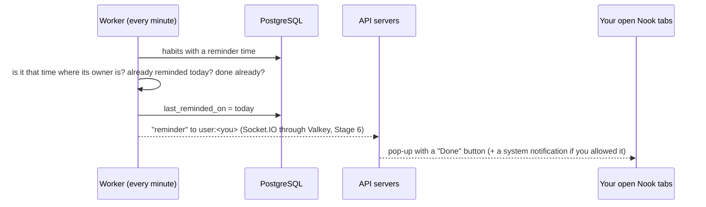

# Stage 13 — Habit & Reading Tracker: dates, scheduled jobs, and working offline

**Goal:** an app you use every day on your phone. Learn how to handle **calendar days and time zones**, run
**scheduled jobs** (reminders every minute), draw **charts** with plain HTML, and keep working **offline**
(a service worker, and changes that wait on the phone until the connection is back).

## 1. What you can do

Open **/habits** (on phones: **Apps → Habits**). It's private: only you see your habits and books.

- **Today**: tick each habit with one big button; tick other days of this week; a 🔥 streak; "every day" or
  "3 days a week" goals; an optional reminder time.
- **Reading**: the books you're reading with a progress bar and **+5 / +10 / +20 / +50 pages** buttons;
  want-to-read and finished shelves; pages per day for 30 days; totals for the week, month and year.
- **Progress**: 12 weeks per habit, one square per day.
- Finishing a book, or a 7 / 30 / 100 / 365-day streak, shows up in everyone's live feed.

## 2. Days, not moments

"Did I read **today**?" depends on where you are: 03:00 on the 11th in Hanoi is still the 10th in London.
So habits and reading store **calendar days** (`date` columns, `"2026-11-11"`), worked out in **your** time zone,
which the browser sends with every request (`X-Time-Zone: Asia/Ho_Chi_Minh`). The rules are small functions in
`api/src/habits/days.ts`, with tests:

- **Streak:** days in a row up to today. Today not ticked yet doesn't break it: you still have until midnight.
- **Weekly goals** ("3 days a week"): weeks in a row that reached the goal; the streak is in weeks.
- Weeks start on **Monday**.

## 3. Reminders: a job every minute



- The schedule is a **BullMQ job scheduler** (like cron): kept in Valkey, so with several workers it still runs
  once a minute in total. A minute missed while the worker restarts is caught up (up to an hour late).
- **Limit:** reminders reach Nook tabs that are open (also in the background). Real push notifications to a
  closed phone app need HTTPS and a push service; on `http://192.168.x.x` phones only get the in-page pop-up.
  System notifications work on `https://localhost` (or https through Caddy).

## 4. Working offline

Two parts:

1. **Changes wait on the phone** (`web/lib/offline.ts`). Ticking a habit or adding pages tries the API; if the
   network is down, the request is kept in `localStorage` and the screen shows it as done anyway. An amber
   "N waiting to sync" pill shows until it's sent: when the browser says it's back online (with a few quick
   retries, because "online" often fires a moment early), when you come back to the tab, and every 20 s.
   Ticking a habit on, off and on while offline sends one request (the latest wins). The habit list itself is
   also kept, so the page shows something offline.
2. **A service worker** (`web/public/sw.js`) keeps copies of the pages and their files, so `/habits` even
   **opens** without a connection. Plus a **web app manifest** (`web/app/manifest.ts`) and icons, so phones can
   "Add to Home Screen" and open Nook full screen like an app.
   Browsers only run service workers on secure pages (https, or localhost); in development it's off.

## 5. Charts without a chart library

Both charts are plain HTML and Tailwind: the 12-week grid is a CSS grid that fills top-to-bottom
(`grid-flow-col grid-rows-7`), and pages per day are 30 bars whose height is a percentage of the best day.

## 6. Tests

- API: time zones, Mondays, streaks (today not done yet; weekly goals), ticking days (private, only the last 30
  days), reminders (on time, once a day, not when done), reading (pages add up, finishing a book, stats, private)
  (`habits.test.ts`).
- Web: the offline queue (kept when offline, sent later, latest change wins, refused requests dropped)
  (`offline.test.ts`). It found a bug while testing in the browser: the first sync with nothing to send left the
  queue stuck "busy", so later syncs never ran. Fixed, and the test covers it.
- Tried in Chromium on an emulated iPhone 13: adding habits, ticking, going **offline** and back (the tick synced),
  reading, and a **real reminder** sent by the worker a minute after setting it.
- The production build on `http://localhost` (an emulated iPhone 13): the service worker installed, and with the
  network switched off `/habits` still opened from the saved copy.
- **Not tested:** a real phone, and "Add to Home Screen".

## Files

```
api/src/habits/days.ts            days, weeks, streaks, time zones
api/src/routes/habits.ts          habits and books
api/src/jobs/reminders.ts         the every-minute reminder job
api/drizzle/0012_habits_reading.sql
web/features/habits/              Today, Reading, Progress, reminders, offline sync, service worker registration
web/lib/offline.ts                changes that wait on the device
web/public/sw.js · web/app/manifest.ts · web/public/icons/
```
