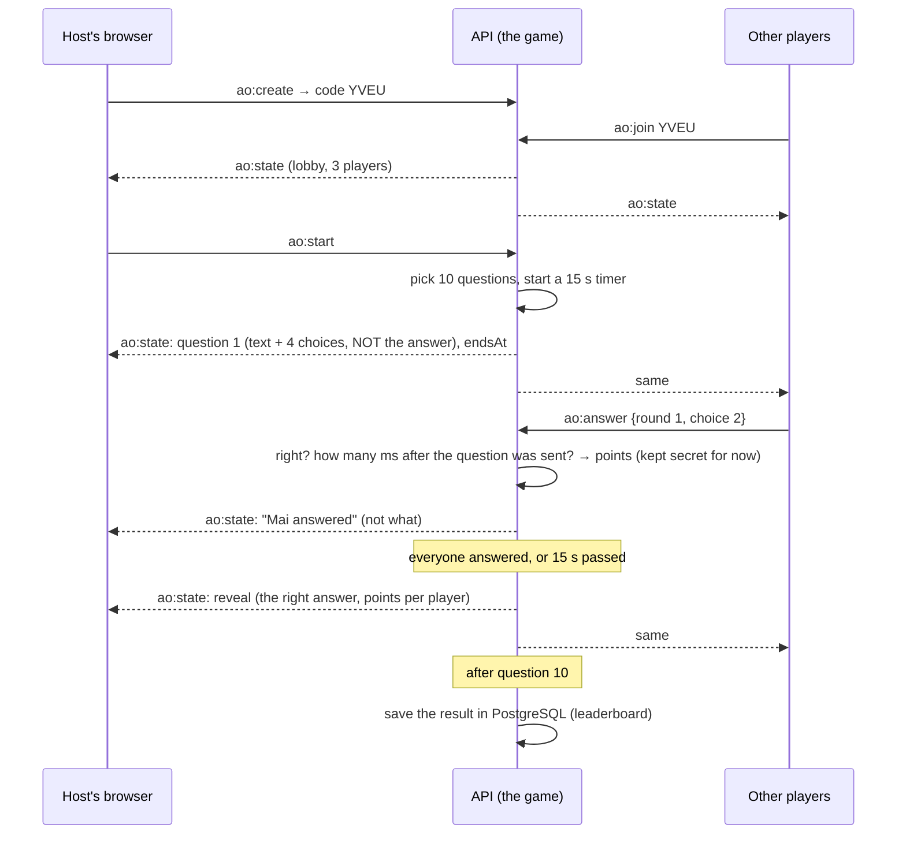

# Stage 14 — Arcade Online: a multiplayer game the server runs

**Goal:** a real-time game for several people, where the **server is in charge**: it keeps the answers, runs the
clock, measures how fast each answer came and adds up the points. Browsers only send "I pick answer 2" and draw
what the server says. That's how online games stop cheating, and it's the difference from Mini Arcade
(Stage 10), where the browser sends its own score.

## 1. Quiz Party

Open **/arcade-online** (on phones: **Apps → Quiz**).

1. Someone presses **Start a room** (any category: mixed, general knowledge, science, music, movies/TV/games, food)
   and gets a 4-letter code, e.g. **YVEU**.
2. Others join with the code, or tap the room in **Open rooms** (the list updates live). Up to 8 players.
3. The host presses **Start**. 10 questions, 15 seconds each, four coloured answers (with shapes, for colour-blind
   players). A right answer is worth 500 points plus up to 500 more for speed.
4. When everyone has answered (or time is up), the right answer shows, with points per player.
5. A podium at the end; **Play again** for the host. Results go to the **Leaderboard** (wins, games, points), and
   the winner shows in everyone's live feed.

There are 62 questions, written for Nook (`api/src/arcade-online/questions.ts`). Add your own there.

## 2. How it works



- **The game** (`api/src/arcade-online/game.ts`) is a small *state machine*: `lobby → question → reveal → … →
  final`. It has no network code at all, so tests drive it directly with a fake clock (no waiting).
- **The rooms** (`rooms.ts`) connect games to Socket.IO: each room is a Socket.IO room (`ao:ABCD`), and every change
  sends the whole room as one snapshot (`ao:state`). Browsers just draw the latest snapshot, so a player who
  reconnects (or opens a second tab) gets back exactly where the game is, with their score.
- **Fair play:** the right answer isn't sent until the reveal; one answer per question; answers after the time are
  refused; the time is measured **on the server** from when it sent the question.
- **Clocks:** every snapshot has `serverNow`, so a phone whose clock is a few seconds off still shows the right
  countdown.
- **Leaving:** in the lobby you leave the room; during a game you stay on the scoreboard as "away" and the game
  stops waiting for you. If the host leaves, the next player becomes host. Empty rooms close after 2 minutes.

**Honest limit:** rooms live in the API process's memory. With one API server (Nook's normal setup) that's fine.
With several API servers behind a load balancer, everyone in a room must reach the same server ("sticky
sessions"), or the room's state would have to move into Valkey. A restart of the API ends the games in progress.

## 3. What's stored

Only finished games: `online_games` (when, category, rounds) and `online_game_players` (score, right answers,
place, how many played). They're deleted with the person (and the daily clean-up removes games with nobody left).
A **win** only counts when at least two people played.

## 4. Tests

- The rules with a fake clock: scoring, the order of phases, early reveal when everyone answered, late / double /
  impossible answers refused, nobody new after the start, players coming back, the host passed on, playing again,
  8 players maximum, the question bank (4 different choices each, no repeats) (`quiz-game.test.ts`).
- A whole game over real Socket.IO with two players and short timers: create, join (lower-case code works), only the
  host starts, answers, reveal, the timer running out, results saved, leaderboard; a guest without a name, a wrong
  code, joining a started game, a player disconnecting in the lobby (`arcade-online.test.ts`).
- Played in Chromium by three people at once (a desktop host and two phones): joining by the list and by code,
  10 rounds, the podium and the leaderboard.
- **Not tested:** real phones on Wi-Fi, and more than three players at once.

## Files

```
api/src/arcade-online/questions.ts   the question bank
api/src/arcade-online/game.ts        one game, run by the server
api/src/arcade-online/rooms.ts       rooms ↔ Socket.IO, saving results
api/src/routes/arcadeOnline.ts       open rooms, leaderboard, categories
api/drizzle/0013_arcade_online.sql
web/features/arcade-online/          lobby, room (waiting, question, reveal, podium), leaderboard
```
