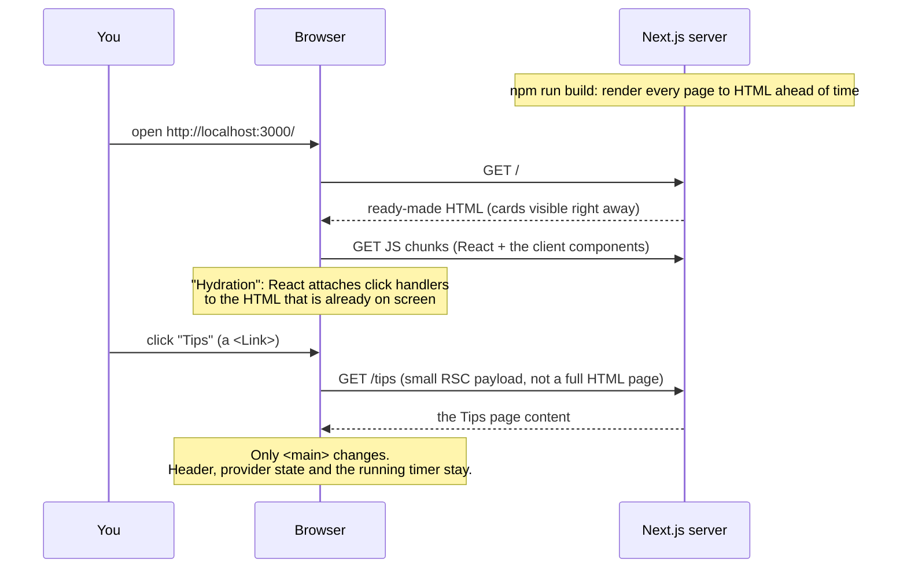
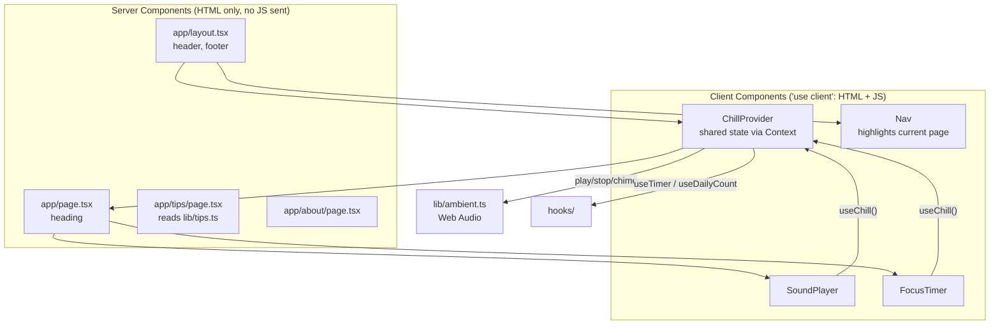

# Stage 2 — Frontend app: Next.js + React + TypeScript

**Goal:** the same Chill Corner, rebuilt the way real apps are built: components,
routing from folders, typed code, and two kinds of components (server and client).

The code is in [`web/`](../web). Stage 1 is kept in [`stage-1-static/`](../stage-1-static) to compare.

## 1. What changed from Stage 1

| Stage 1 (static) | Stage 2 (Next.js) |
|---|---|
| You write `index.html` by hand | React components return JSX; Next.js turns them into HTML |
| 3 script tags, global objects | `import` / `export` modules, bundled by Next.js |
| JavaScript reads and changes the DOM | Components keep **state**; React updates the DOM for you |
| One page per `.html` file | One page per **folder** in `app/` (`app/tips/page.tsx` → `/tips`) |
| Clicking a link reloads everything | `<Link>` swaps the page only; the timer keeps running |
| JavaScript, no types | TypeScript catches mistakes before the code runs |

## 2. The request flow



Try it: run the app, open DevTools → Network, and click **Tips**.
You'll see a small `tips?_rsc=...` request, not a full page reload, and the timer keeps counting.

## 3. Server Components vs Client Components



**The rule:** a component is a Server Component unless its file starts with `"use client"`.
Add `"use client"` only when you need state, effects, event handlers or browser APIs.

- `app/tips/page.tsx` just shows data → server. The tips data never ships to the browser as JS.
- `SoundPlayer` needs clicks and Web Audio → client.

## 4. The code that connects the parts

**Routing = folders.**

```
app/page.tsx              → /
app/tips/page.tsx         → /tips
app/tips/[slug]/page.tsx  → /tips/one-thing, /tips/real-breaks, ...
app/about/page.tsx        → /about
app/not-found.tsx         → any unknown URL (404)
```

**Props: data flows down.** `PillButton` is written once and reused for tracks and modes:

```tsx
<PillButton className="track" pressed={playing === t.name} onClick={() => toggleTrack(t.name)}>
  {t.label}
</PillButton>
```

**State: React re-renders for you.** No more `element.textContent = ...`:

```tsx
const [playing, setPlaying] = useState<TrackName | null>(null);
// ...
<p>{current ? `Now playing: ${current.label}` : "Nothing playing"}</p>
```

**Context: shared state without passing props through every level.**
`ChillProvider` sits in the root layout, which never unmounts, so the timer survives page changes:

```tsx
// app/layout.tsx
<ChillProvider>
  <main id="main">{children}</main>
</ChillProvider>

// any client component
const { time, start, pause } = useChill();
```

**Custom hooks: logic reused without UI.** `useTimer` keeps the Stage 1 idea (store the end time, not ticks),
and `useEffect` cleans up its interval on pause:

```ts
useEffect(() => {
  if (endAt === null) return;
  const id = setInterval(() => { /* update remaining */ }, 250);
  return () => clearInterval(id); // cleanup
}, [endAt]);
```

**Dynamic route + static generation.** Each tip page is built at `npm run build`:

```tsx
export function generateStaticParams() {
  return tips.map((tip) => ({ slug: tip.slug }));
}
```

**TypeScript.** `type TrackName = "rain" | "waves" | "keys"` means `play("snow")` is an error in your editor
before you ever run the page.

## 5. Things worth noticing

- **Hydration and localStorage:** the server can't read your browser's storage, so it renders `0` sessions,
  then `useDailyCount` reads the real number in an effect. Reading it during render would make the server HTML
  and browser HTML disagree (a "hydration mismatch").
- **Build output:** `npm run build` prints `○` (static) and `●` (pre-rendered with `generateStaticParams`)
  next to each route. Every page here is static, because nothing depends on the request yet.
  In Stage 3, pages that read from the database will become dynamic.
- **Same CSS:** `app/globals.css` is Stage 1's stylesheet, so you can compare the two versions side by side.

## 6. Run it

```bash
cd web
npm install
npm run dev        # development: http://localhost:3000, reloads on save
npm run build      # production build (shows the route table)
npm start          # serve the production build
npm run typecheck  # TypeScript check only
```

## 7. Next: Stage 3

Stage 3 adds a **Node API and PostgreSQL**. The focus session count moves from localStorage into a real database,
so it follows you across devices, and you'll see the frontend call the API, and the API validate and save data.
