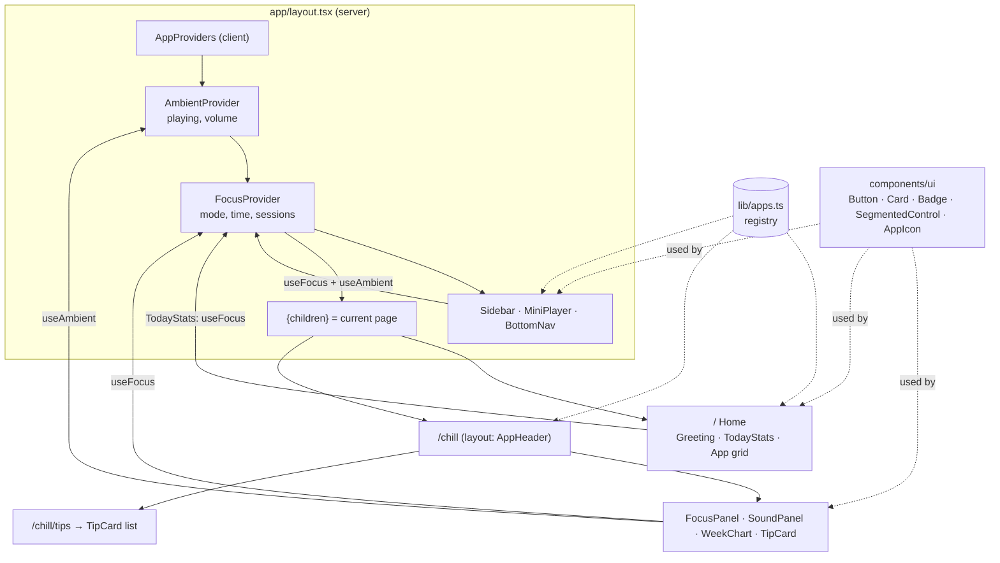
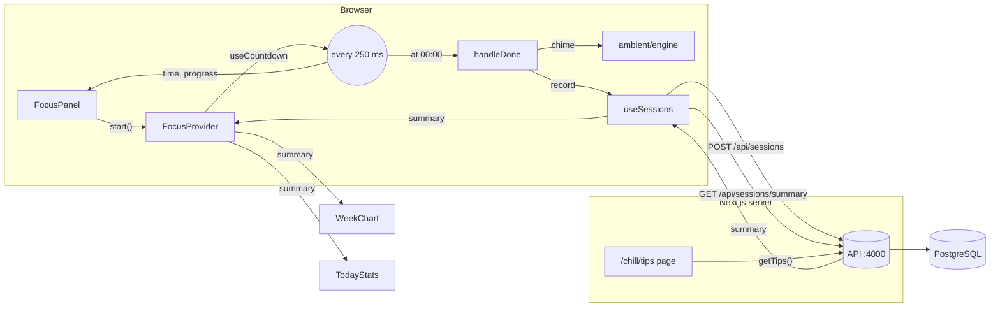

# Stage 3.5 — Frontend review, structure for many apps, and a new design

**Question:** can MyWeb take the other apps in the plan (Mini Arcade, WatchList, Hobby Hub, Habit Tracker,
Arcade Online, Free-time Companion) without turning into a mess?

**Short answer:** not with the Stage 3 layout. It was built for one app. Stage 3.5 reorganises the frontend
so a new app is **one registry entry + one folder**, and gives everything a shared design system.

## 1. Review of the Stage 3 frontend

| # | Problem | Why it matters | Fix in 3.5 |
|---|---|---|---|
| 1 | Flat folders: `components/`, `hooks/`, `lib/` mixed every concern | With 7 apps, you can't tell what belongs to what | **Feature folders**: `features/ambient`, `features/focus`, `features/tips` |
| 2 | One big `ChillProvider` held sound **and** timer | The timer ticks 4×/second, so every sound component re-rendered 4×/second too | **Two providers**: `AmbientProvider` and `FocusProvider` |
| 3 | Chill Corner *was* the home page; nav links hard-coded | No room for a second app | **App registry** (`lib/apps.ts`) drives the Home grid, sidebar, tab bar and app tabs |
| 4 | One global CSS file, styles written per page | Every new app would copy-paste styles | **Design tokens + Tailwind + UI kit** (`components/ui`) |
| 5 | API calls in one file, no timeout, no typed errors | A stuck API could hang a page; 404 vs 500 was guesswork | **`lib/api/client.ts`** (`apiFetch`, timeout, `ApiError`) + one file per feature |
| 6 | Timer length was reset by an effect watching a prop | Hard to follow; showed a stale value for a moment in tests | `useCountdown().set(ms)` called directly when you pick a mode |
| 7 | When the timer hit zero, a late tick could fire "done" twice | Could save the same session twice | Interval is cleared the moment it reaches zero (found by a new test) |
| 8 | Pause kept the value from the last 250 ms tick | Lost up to ¼ s per pause | Pause reads the exact time left |
| 9 | No frontend tests | Refactors were risky | **13 tests** (Vitest + Testing Library) |
| 10 | No responsive navigation for many apps | Phones had a cramped top bar | **Sidebar** on desktop, **bottom tab bar** on phones |

## 2. New folder structure

```
web/
  app/                         ROUTES ONLY: thin pages that arrange features
    layout.tsx                 shell: providers, sidebar, mini player, tab bar
    page.tsx                   Home hub (grid built from the registry)
    chill/
      layout.tsx               Chill Corner header + tabs (Focus | Tips)
      page.tsx                 /chill
      tips/page.tsx            /chill/tips
      tips/[slug]/page.tsx     /chill/tips/:slug
    about/page.tsx
  features/                    EACH FEATURE OWNS ITS STATE, LOGIC AND UI
    ambient/                   engine.ts (Web Audio), AmbientProvider, SoundPanel, TrackCard
    focus/                     useCountdown, FocusProvider, FocusPanel, TimerRing, WeekChart, TodayStats
    tips/                      TipCard
  components/
    ui/                        DESIGN SYSTEM: Button, Card, Badge, SegmentedControl, AppIcon
    shell/                     APP FRAME: Sidebar, BottomNav, MiniPlayer, AppHeader, Aurora, AppProviders
  lib/
    apps.ts                    APP REGISTRY: every app, its icon, colour, status, sub-pages
    api/                       client.ts (shared fetch) + tips.ts, sessions.ts, clientId.ts
    cn.ts                      class-name helper
  tests/                       Vitest tests
```

**The rule of thumb:** `app/` decides *where* things appear, `features/` decides *what they do*,
`components/ui` decides *how they look*. A page should mostly be layout and data loading.

## 3. Component relationships



Why the MiniPlayer stays in sync with the Chill page: both read **the same providers**.
There's one timer and one sound engine; the pages are just different views of them.

## 4. Data flow



Data goes **down** through props and context; actions go **up** through functions like `start()` and `toggle()`.
Server Components (Tips) fetch on the server; Client Components (timer, sessions) fetch from the browser.

## 5. How to add a new app (example: Mini Arcade)

1. **Register it.** In `lib/apps.ts`, change Mini Arcade's `status: "soon"` to `"live"` and add `links`:
   ```ts
   links: [
     { href: "/arcade", label: "Games" },
     { href: "/arcade/scores", label: "High scores" },
   ],
   ```
   The sidebar, phone tab bar and Home grid update automatically.
2. **Give it a layout** with the shared header and tabs: `app/arcade/layout.tsx`
   ```tsx
   export default function ArcadeLayout({ children }) {
     return <><AppHeader appId="arcade" />{children}</>;
   }
   ```
3. **Add its pages**: `app/arcade/page.tsx`, `app/arcade/scores/page.tsx`.
   Run `npm test`: `tests/apps.test.ts` fails if a link in the registry has no page.
4. **Put its logic in a feature folder**: `features/arcade/` (game loop, `useHighScores`, `GameCard`).
   Build screens from `Card`, `Button`, `Badge` so it matches everything else.
5. **If it needs data**, add `lib/api/arcade.ts` using `apiFetch`, and a router in `api/src/routes/`.
6. **Only if it needs state shared across apps** (rare), add its provider to `components/shell/AppProviders.tsx`.
   Most apps keep state inside their own pages.

Features can be **reused across apps**. The future Free-time Companion can show `WeekChart` or call
`useFocus()` without copying anything, and the Habit Tracker can read the same focus sessions.

## 6. The design system

- **Tokens** (`app/globals.css`): every colour is a variable (`--primary`, `--surface`, `--muted`...).
  Light and dark themes only swap the values, and Tailwind turns them into classes like `bg-surface` and `text-muted`.
- **UI kit** (`components/ui`): `Button` (primary / secondary / ghost, 4 sizes), `Card` + `CardHeader`, `Badge`,
  `SegmentedControl`, `AppIcon`. New screens are built from these, not from new CSS.
- **Look**: frosted-glass cards over slowly drifting colour blobs ("aurora"), a violet→pink accent gradient,
  one gradient icon tile per app, Plus Jakarta Sans font, Lucide icons.
- **Layout**: sidebar on desktop, bottom tab bar on phones, a floating **mini player** for sound and timer.
- **Accessibility kept**: real buttons and links, `aria-pressed` toggles, `aria-current` for the active page,
  skip link, visible focus rings, text alternatives for the chart, and `prefers-reduced-motion` turns animations off.

## 7. Other things checked

| Area | Status |
|---|---|
| **Security** | No secrets in the frontend; API URL comes from env vars. User text is rendered by React (escaped), no `dangerouslySetInnerHTML`. API keeps Zod validation, CORS and helmet. |
| **Performance** | Home and About are static. Only interactive parts ship JS. The font is self-hosted. Split providers cut needless re-renders. |
| **Resilience** | API down → "Offline" in the timer and chart, "Tips are resting" page, and Chill Corner still loads (the tip is skipped). Requests time out after 5 s. |
| **Old links** | `/tips` and `/tips/:slug` redirect permanently to `/chill/tips/...`. |
| **Tests** | API: 10 tests. Web: 13 tests (timer logic, countdown hook, registry guards, components). |

## 8. Still to do later (and when)

| Item | Why | When |
|---|---|---|
| Shared types between `web/` and `api/` (one package of Zod schemas) | Today the `Tip` and `Summary` types are written twice and could drift | When the 2nd app adds API endpoints |
| ESLint + Prettier | Catch mistakes and keep formatting consistent | Stage 8 (CI) |
| Light/dark toggle (now follows the system) | Personal preference | Any time; small |
| Real accounts instead of an anonymous client id | Sessions should follow you across devices | **Stage 4** |
| Rate limiting on the API | Stop someone flooding `POST /api/sessions` | Stage 4–5 |
| End-to-end tests (Playwright) in CI | Click through the real app on every push | Stage 8 |

## 9. Run it

Same as Stage 3 (database → API → web). Web tests:

```bash
cd web
npm test           # 13 tests
npm run build      # route table: / and /about static, /chill pages dynamic
```
