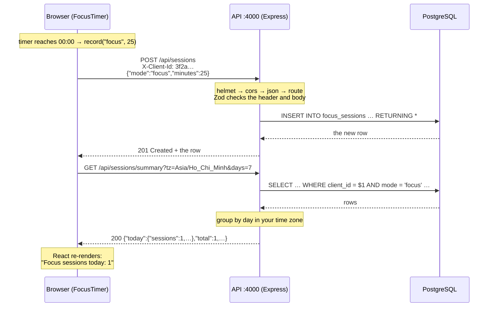
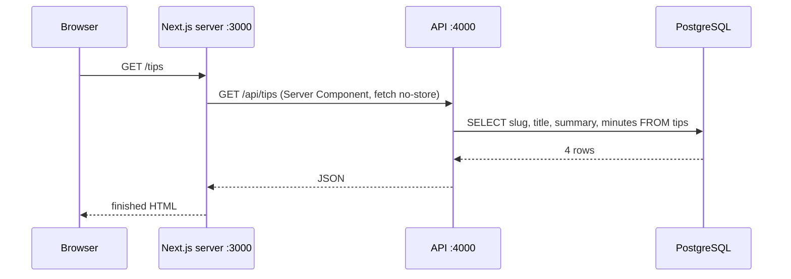
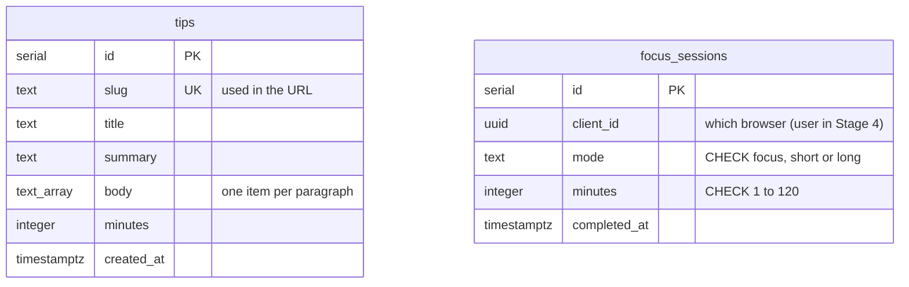

# Stage 3 — API + database: Node.js, Express, PostgreSQL

**Goal:** see how the frontend calls an API, how the API checks the input and saves it,
and what a database schema is. Chill Corner now has three parts that run separately:

| Part | Folder | Runs on | Job |
|---|---|---|---|
| Website | `web/` | http://localhost:3000 | Pages and buttons (Next.js) |
| API | `api/` | http://localhost:4000 | Rules: checks input, reads and writes data (Express) |
| Database | — | localhost:5432 | Keeps the data safe (PostgreSQL) |

**Only the API talks to the database.** The browser and the Next.js server both go through the API.

## 1. What moved where

| Data | Stage 2 | Stage 3 |
|---|---|---|
| Focus sessions | `localStorage` in one browser | `focus_sessions` table in PostgreSQL |
| Tips | `lib/tips.ts`, built into the pages | `tips` table; pages ask the API on every request |

Sessions are tied to an anonymous **client id** (a random UUID kept in your browser).
Stage 4 (login) will link them to a real account, so they follow you across devices.

## 2. Request flow: finishing a focus session



If the data is wrong, the API stops at the Zod check and answers **400** with details,
and nothing reaches the database:

```json
POST /api/sessions  {"mode":"nap","minutes":999}
→ 400 {"error":"Invalid request","details":[{"path":"mode",…},{"path":"minutes",…}]}
```

## 3. Request flow: opening the Tips page



Here the **Next.js server** is the API's client, not the browser. That's why the build table changed:

```
○ /             static  (same for everyone)
ƒ /tips         dynamic (asks the database on every request)
ƒ /tips/[slug]  dynamic
```

Try it: with everything running, add a tip in SQL and reload `/tips`. It appears straight away, with no rebuild:

```sql
INSERT INTO tips (slug, title, summary, body, minutes)
VALUES ('water', 'Drink water', 'Keep a glass on your desk.', '{"Thirst feels like tiredness."}', 1);
```

## 4. The database schema



- **Primary key (PK):** a unique number for each row.
- **Unique (UK):** two tips can't share a slug.
- **CHECK constraints:** the database refuses bad rows even if the API had a bug. That gives two layers of safety.
- **Index** on `(client_id, completed_at)`: makes "this browser's sessions this week" fast as the table grows.
- **timestamptz:** stores the exact moment in UTC. The API turns it into "which day" using *your* time zone.

The schema is written in TypeScript (`api/src/db/schema.ts`). `npm run db:generate` turns it into SQL
(`api/drizzle/0000_init.sql`), and `npm run db:migrate` runs that SQL once.
To change the schema later: edit `schema.ts` → generate → migrate. Never edit an old migration.

## 5. The code that connects the parts

**Middleware: every request passes through these in order** (`api/src/app.ts`):

```ts
app.use(helmet());                              // security headers
app.use(cors({ origin: config.WEB_ORIGIN }));   // only our website may call from a browser
app.use(express.json({ limit: "10kb" }));       // parse JSON bodies
app.use("/api/tips", tipsRouter);
app.use("/api/sessions", sessionsRouter);
app.use(notFound);                              // nothing matched → 404
app.use(errorHandler);                          // something threw → 400 / 404 / 500
```

**Validate, then save** (`api/src/routes/sessions.ts`):

```ts
const newSession = z.object({
  mode: z.enum(["focus", "short", "long"]),
  minutes: z.number().int().min(1).max(120),
});

sessionsRouter.post("/", async (req, res) => {
  const id = clientId(req);                      // header must be a UUID
  const input = newSession.parse(req.body);      // throws → errorHandler → 400
  const [saved] = await db.insert(focusSessions).values({ clientId: id, ...input }).returning();
  res.status(201).json(saved);
});
```

Drizzle sends **parameterised SQL** (`… WHERE slug = $1`), so user input is never glued into the SQL text.
That's what prevents SQL injection.

**The frontend calls the API** (`web/lib/api.ts`):

```ts
await fetch(`${BROWSER_API}/api/sessions`, {
  method: "POST",
  headers: { "Content-Type": "application/json", "X-Client-Id": clientId() },
  body: JSON.stringify({ mode, minutes }),
});
```

**CORS, in one paragraph:** the website (port 3000) and the API (port 4000) are different *origins*.
Browsers block one origin from reading another's responses unless the API says it's allowed.
`cors({ origin: "http://localhost:3000" })` adds that permission for our site only.
Server-to-server calls (Next.js → API) don't involve CORS. It's a browser rule.

**When the API is down** nothing crashes. The timer card says "Offline: start the API…", and
`app/tips/error.tsx` shows "Tips are resting" with a Try again button. The header and running timer stay.

## 6. HTTP status codes used

| Code | Meaning | When |
|---|---|---|
| 200 | OK | reading tips, summary |
| 201 | Created | a session was saved |
| 400 | Bad Request | Zod rejected the input, broken JSON, missing client id |
| 404 | Not Found | unknown tip or route |
| 500 | Server Error | our bug: logged on the server, no details sent to the client |

## 7. Run it

You need PostgreSQL. The easiest way is Docker (only for the database, for now):

```bash
docker compose up -d db            # from the repo root
```

Or install PostgreSQL 16 yourself and create a user `myweb` / password `myweb` with a database `myweb`.

Then, in two terminals:

```bash
# Terminal 1: the API
cd api
cp .env.example .env
npm install
npm run db:migrate                 # create the tables
npm run db:seed                    # add the 4 starting tips
npm run dev                        # http://localhost:4000/health → {"ok":true}

# Terminal 2: the website
cd web
npm install
npm run dev                        # http://localhost:3000
```

Tests (they use a separate `myweb_test` database; create it once):

```bash
docker compose exec db createdb -U myweb myweb_test
cd api && npm test                 # 10 tests: real HTTP requests against a real database
```

Look inside the database:

```bash
docker compose exec db psql -U myweb -c "select * from focus_sessions order by id desc limit 5;"
```

## 8. Next: Stage 4

Stage 4 adds **login** (sessions and OAuth). You'll see how the browser, the API and the database agree on
who you are (cookies), and `client_id` becomes a real `user_id`, so your focus history follows you to any device.
