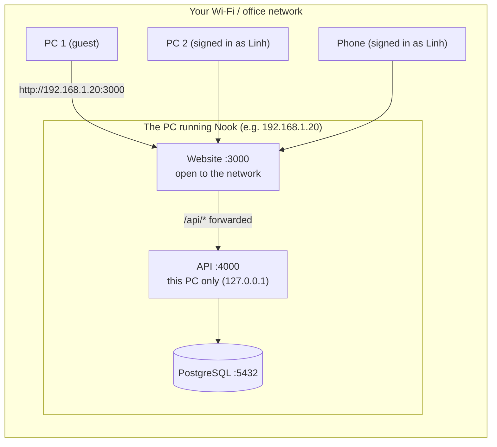
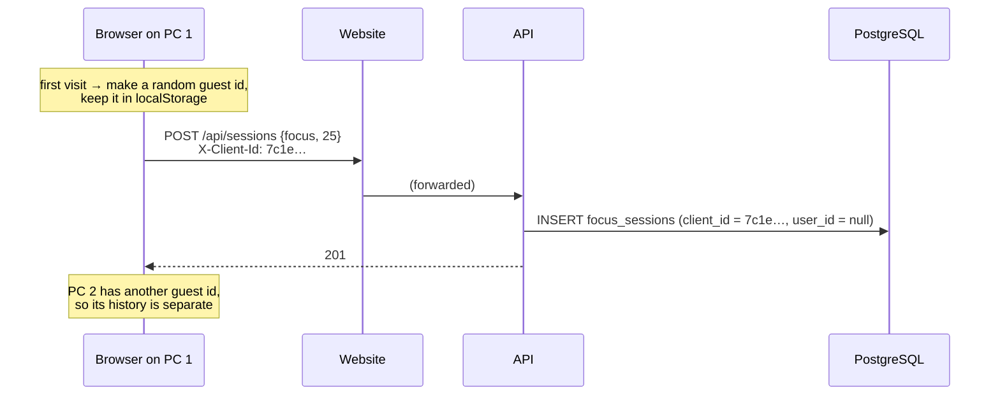
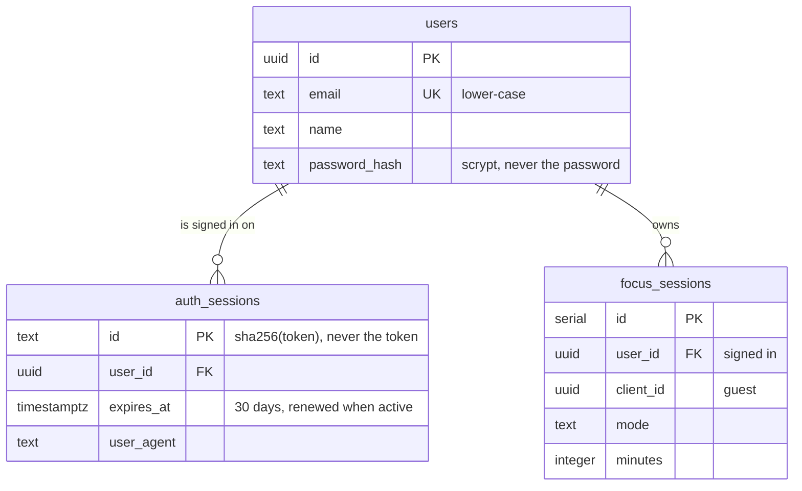

# Stage 4 — Many users, guests first, optional accounts

**Goal:** several people on different PCs (and phones) use Nook at the same time, from your home or office network.
Everyone can do **everything as a guest first**. An account is optional: it only adds "my history on every device".

What's new:
- **Open Nook from other PCs** at `http://<your-PC's-IP>:3000`
- **Guests**: each PC or browser automatically gets its own private history, with no sign-up needed
- **Optional accounts** (email + password): sign in on any device to see the same history.
  What you did as a guest moves into your account.
- **Account page** (`/account`), and a Guest / user card in the sidebar and phone header

> Earlier drafts of this stage had "Continue with GitHub". It was removed, because guests-first use on
> your own network matters more and needs no outside service.

## 1. Use Nook from other PCs



Only **port 3000** is reachable from the network. The API and the database stay private on the host PC:
other PCs can only reach them through the website. Fewer open doors means fewer ways in.

### Step by step

1. **Start everything on one PC** (the "host"):
   ```bash
   docker compose up -d db
   cd api && npm run db:migrate && npm run dev
   cd web && npm run build && npm start        # listens on all network addresses (0.0.0.0)
   ```
2. **Find the host PC's IP address**:
   - Windows: `ipconfig` → "IPv4 Address" (e.g. `192.168.1.20`)
   - macOS: System Settings → Wi-Fi → Details, or `ipconfig getifaddr en0`
   - Linux: `hostname -I`
3. **Allow port 3000 through the firewall** if asked (Windows shows a pop-up the first time; choose *Private networks*).
4. On any other PC or phone on the **same network**, open **`http://192.168.1.20:3000`**.

That's it: every visitor is a guest right away.

**Dev mode** (`npm run dev`, with live reload) also works from other PCs. `next.config.ts` allows the usual home and
office address ranges (`192.168.*.*`, `10.*.*.*`, `172.*.*.*`, `*.local`). For another range, start it with
`DEV_ORIGINS="100.64.*.*" npm run dev`. When several people use it, prefer `npm run build && npm start`: it's faster.

## 2. Guests first



- Every page and feature works without an account.
- The guest id is just a random UUID. It isn't secret and can't be guessed, and it only links *this browser's*
  focus sessions together.
- If you clear the browser data, you get a new guest.

**Bug found while testing on a network address:** browsers treat `http://localhost` as "secure" but
`http://192.168.1.20` as **not** secure, and switch off some features there, including `crypto.randomUUID()`.
The guest id used it, so on other PCs the stats stayed empty and sign-up failed.
`lib/api/clientId.ts` now builds the UUID from `crypto.getRandomValues()`, which works everywhere, and a test simulates the non-secure page.
(Stage 7 adds HTTPS, which makes every page secure.)

## 3. Optional accounts: what actually happens

```mermaid
sequenceDiagram
    participant B as Browser
    participant A as API
    participant D as PostgreSQL

    B->>A: POST /api/auth/login {email, password}<br/>Origin: http://192.168.1.20:3000
    Note over A: Origin matches the site the browser opened? (CSRF check)<br/>→ rate limits → Zod validates
    A->>D: SELECT * FROM users WHERE email = $1
    D-->>A: password_hash = "scrypt$16384$8$1$salt$hash"
    Note over A: scrypt(password, salt) == hash?  (constant-time compare)
    Note over A: token = 32 random bytes
    A->>D: INSERT auth_sessions (id = sha256(token), user_id, expires_at)
    A->>D: UPDATE focus_sessions SET user_id … WHERE client_id = this guest
    A-->>B: 200 {user}<br/>Set-Cookie: myweb_session=token; HttpOnly; SameSite=Lax
```

On **every later request** the browser sends the cookie. The API hashes the token, finds the session row and
the user, and sets `req.user`. **Sign out** deletes the row, so the token is dead immediately, even if someone copied it.

**Sessions or JWT?** We use server sessions (a random token plus a database row) rather than JWTs (signed user data in the cookie).
With sessions, signing out or blocking someone takes effect **instantly**. A JWT stays valid until it expires.
The cost is one fast, indexed lookup per request, which Stage 5 can cache in Valkey.

## 4. Who sees what

| You are | You see |
|---|---|
| A guest on PC 1 | Only PC 1's guest sessions |
| A guest on PC 2 | Only PC 2's guest sessions |
| Signed in as Linh (any device) | All of Linh's sessions, including guest sessions done before signing up/in |
| A guest on PC 2 *after* Linh signs out there | Nothing of Linh's: signed out, you only see sessions that were never moved into an account |

## 5. The database



Migrations: `0001_auth.sql` (accounts), `0002_guests_first.sql` (removes the GitHub table and column;
any GitHub-only test accounts are deleted, because they have no password and could never sign in).

## 6. Security, with many people on one network

| Threat | Protection | Where |
|---|---|---|
| Database stolen → passwords | **scrypt** + random salt per user | `api/src/auth/password.ts` |
| Database stolen → sign in as someone | Only **sha256(token)** is stored | `api/src/auth/sessions.ts` |
| A script on the page steals the cookie | **HttpOnly** cookie | cookie options |
| Another website makes your browser POST to Nook (CSRF) | **SameSite=Lax** + **Origin must match the address you opened** + **JSON only** | `api/src/middleware/security.ts` |
| Password guessing | 10 tries / 15 min **per email**, plus a shared cap for floods | `api/src/routes/auth.ts` |
| Learning which emails have accounts (via login) | Same message and timing for "unknown email" and "wrong password" | `burnTime()` |
| Redirect to a fake site after sign-in | `next` must start with one `/` | `safeNext()` |
| The API or database reached from the network | API listens on **127.0.0.1** only; only port 3000 is open | `api/.env` `HOST` |

**The address check.** People can open Nook as `localhost:3000`, `192.168.1.20:3000` or `mypc.local:3000`.
So instead of one fixed address, the API compares the request's `Origin` with the address the browser
actually opened (the Next.js proxy passes it on as `X-Forwarded-Host`). A bad website can't fake either one,
because the browser sets both. For a special case, list extra addresses in `ALLOWED_ORIGINS`.

**Why rate limits aren't per IP.** Behind the Next.js proxy, every visitor reaches the API from `127.0.0.1`.
Next.js also passes the browser's `X-Forwarded-For` header on unchanged, so a visitor could fake any IP.
A per-IP limit would either lump **everyone on your network into one counter** (one person's typos would lock
out everybody) or be easy to dodge. So we limit **per email** for sign-in, and **per user or guest** for saving
sessions. Stage 7's Caddy will provide real IPs.

**Trade-offs to know:**
- It's plain **HTTP** on your network, so others on the same Wi-Fi could in theory read the traffic, passwords included.
  That's fine for a home learning project. Stage 7 adds HTTPS.
- Sign-up says "That email already has an account", which tells people that email is registered. It's friendlier, but less private.

## 7. Frontend notes

- **`AuthProvider`** holds `user`. The root layout asks the API on the server (forwarding the visitor's cookie),
  so the first HTML already shows "Guest" or your name, with no flash.
- Every page is now **rendered per visitor** (`ƒ` in the build table), because it shows who you are.
- **`/account`** is checked on the server: a guest is redirected to `/login?next=/account` before any HTML is sent.
- **`app/(auth)/`** is a *route group*: it holds `/login` and `/register` without adding `(auth)` to the URL.
- Signing in or out calls `router.refresh()`, and `FocusProvider` reloads the history because `user.id` changed.
- **`GuestNotice`** on Home and the **Guest card** in the sidebar make it clear an account is optional.

## 8. API endpoints

| Method | Path | Answer |
|---|---|---|
| POST | `/api/auth/register` | 201 `{user}` + cookie · 400 invalid · 409 email taken · 429 too many |
| POST | `/api/auth/login` | 200 `{user}` + cookie · 401 wrong email or password · 429 |
| POST | `/api/auth/logout` | 204, cookie cleared |
| GET | `/api/auth/me` | `{user}` or `{user: null}` (guest) |
| POST | `/api/sessions` | as a guest (`X-Client-Id`) or a user (cookie) |
| GET | `/api/sessions/summary` | your history: guest or user |

## 9. Tests

- `cd api && npm test`: **27 tests**, including another PC's address being allowed, a page on a different address being blocked,
  guest sessions moving into an account, history on a second device, and per-email limits.
- `cd web && npm test`: **16 tests**, including the guest-id fallback for non-secure pages.
- A browser run with **three simulated devices** at `http://192.0.2.2:3000`: two guests with separate histories, one signs up,
  a phone signs in and sees the same history.

## 10. Next: Stage 5

**Valkey (cache + queue + worker):** shared rate-limit counters and a cached session lookup (so several API servers can share them),
plus a background worker for slow jobs.
