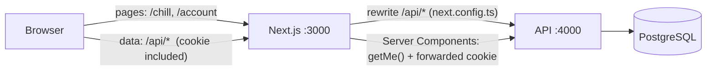
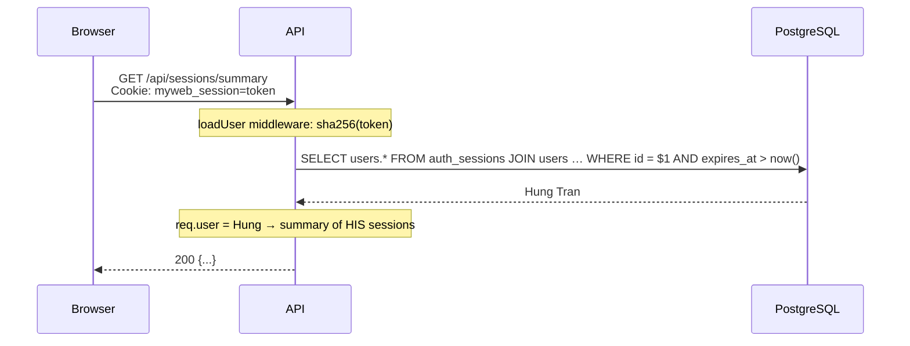
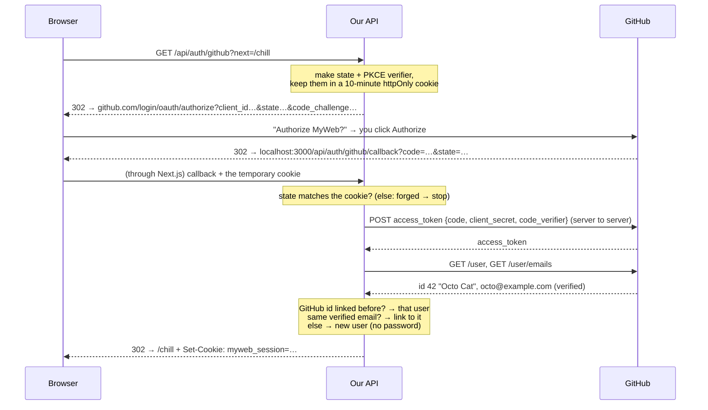
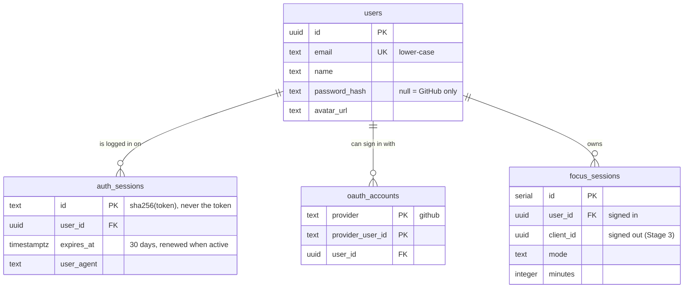

# Stage 4 — Login: sessions, cookies and GitHub OAuth

**Goal:** see how the browser, the API and the database agree on *who you are*.

New in MyWeb:
- **Create account / Sign in** with email and password
- **Continue with GitHub** (OAuth), switched on when you add your own GitHub app keys
- **Account page** (`/account`), user menu in the sidebar and phone tab bar
- Your **focus history follows you** to any device; sessions you finished before signing up are kept

## 1. One address for everything

Stage 3 had the browser call the API on another port (`:4000`), which needed CORS.
Now the browser only ever talks to the website, and Next.js forwards `/api/*` to the API:



Why: the login cookie becomes a plain **first-party cookie** for `localhost:3000`, there's no CORS to configure,
and GitHub can send people back to `http://localhost:3000/api/auth/github/callback`.
In Stage 7, **Caddy** takes over this forwarding job.

> The API address in the rewrite is fixed when you run `npm run build`. If your API moves,
> set `API_URL` and build again.

## 2. Sign in: what actually happens

```mermaid
sequenceDiagram
    participant B as Browser
    participant A as API
    participant D as PostgreSQL

    B->>A: POST /api/auth/login {email, password}<br/>Origin: http://localhost:3000
    Note over A: CSRF check (Origin + JSON) → rate limits (IP, email)<br/>→ Zod validates the body
    A->>D: SELECT * FROM users WHERE email = $1
    D-->>A: row with password_hash = "scrypt$16384$8$1$salt$hash"
    Note over A: scrypt(password, salt) == hash?<br/>(compared in constant time)
    Note over A: token = 32 random bytes
    A->>D: INSERT INTO auth_sessions (id = sha256(token), user_id, expires_at)
    A->>D: UPDATE focus_sessions SET user_id … WHERE client_id = this browser
    A-->>B: 200 {user}<br/>Set-Cookie: myweb_session=token; HttpOnly; SameSite=Lax; Path=/
```

And on **every later request**:



**Sign out** deletes the `auth_sessions` row and clears the cookie, so the token is dead at once,
even if someone copied it.

## 3. Sessions or JWT?

| | **Server sessions (what we use)** | JWT in a cookie |
|---|---|---|
| What the cookie holds | a random token, meaningless alone | the user data, signed |
| Server checks | a database lookup per request | the signature only, no lookup |
| Log out / ban a user | delete the row: works **instantly** | the token stays valid until it expires |
| Good for | one app with a database (us) | many services that can't share a database |

We pick sessions because instant logout matters more than saving one fast indexed lookup.
Stage 5 can cache that lookup in Valkey.

## 4. "Continue with GitHub" (OAuth 2.0 + PKCE)



- We **never see the GitHub password**. GitHub only tells us who you are.
- **state** stops "login CSRF" (someone tricking your browser into finishing *their* login).
- **PKCE** means a stolen `code` is useless without the secret verifier, which never leaves our server.
- The **client secret** stays on the server too; the browser never sees it.
- After login we only redirect to **our own pages** (`/chill`), never to `https://anything`. This prevents "open redirect" tricks.

### Set it up (5 minutes)

1. Go to **github.com → Settings → Developer settings → OAuth Apps → New OAuth App**.
2. Fill in:
   - Application name: `MyWeb (local)`
   - Homepage URL: `http://localhost:3000`
   - Authorization callback URL: `http://localhost:3000/api/auth/github/callback`
3. Create it, then **Generate a new client secret**.
4. Put both values in `api/.env` (this file is git-ignored, so it is never committed):
   ```
   GITHUB_CLIENT_ID=Ov23li...
   GITHUB_CLIENT_SECRET=...
   ```
5. Restart the API. The "Continue with GitHub" button appears on `/login` and `/register`.

Without keys, the button is simply hidden. The tests use a **fake GitHub** (`api/tests/auth.test.ts`),
so the whole flow is tested without real keys.

## 5. The database, now with accounts



- `ON DELETE CASCADE`: deleting a user removes their sessions, links and focus history.
- `focus_sessions` has a CHECK: every row has an owner (a user **or** a browser id).
- Migration: `api/drizzle/0001_auth.sql` (generated from `schema.ts`).

## 6. Security checklist

| Threat | Protection | Where |
|---|---|---|
| Database stolen → passwords | **scrypt** with a random salt per user; only the hash is stored | `api/src/auth/password.ts` |
| Database stolen → log in as someone | Only **sha256(token)** is stored, not the token | `api/src/auth/sessions.ts` |
| Malicious script on the page steals the cookie | **HttpOnly** cookie: JavaScript can't read it | cookie options |
| Another site makes your browser POST to us (CSRF) | **SameSite=Lax** + **Origin check** + **JSON only** | `api/src/middleware/security.ts` |
| Password guessing | **Rate limits**: 10 tries / 15 min per IP *and* per email | `api/src/routes/auth.ts` |
| Learning which emails have accounts | Same message and same timing for "unknown email" and "wrong password" | `burnTime()` |
| Redirect to a fake site after login | `next` must start with a single `/` | `safeNext()` (API and web) |
| Shared computer after logout | Signed out, you only see sessions that were never claimed by an account | `ownedBy()` in sessions route |
| Cookie sent over plain HTTP | `Secure` flag in production | cookie options |

**Two honest trade-offs:**
- *Register* says "That email already has an account". It's friendlier, but it does reveal that an email is registered.
  Big sites hide this by emailing instead. We'll revisit it when we add email in Stage 5.
- **Real IPs:** we found that Next.js passes the browser's `X-Forwarded-For` header on unchanged and doesn't add the real IP.
  So right now the per-IP limit can be dodged with a fake header, and that's why there's also a **per-email** limit.
  In Stage 7, Caddy will set the real IP.

## 7. The frontend side

- **`AuthProvider`** (client) holds `user`. The **root layout asks the API on the server** (`getMe()` forwards the
  visitor's cookie), so the first HTML already shows your name: no flash of "Sign in".
- Because of that, every page is now **rendered per visitor** (`ƒ` in the build table). That's the price of
  personalised pages. Public content can be cached again in Stage 5.
- **`/account` is protected on the server**: signed out → `redirect("/login?next=/account")` before any HTML is sent.
- **`app/(auth)/`** is a *route group*: it groups `/login` and `/register` in one folder without adding `(auth)` to the URL.
- After signing in: `router.refresh()` re-runs Server Components with the new cookie, and `FocusProvider`
  reloads your sessions because `user.id` changed.
- Forms show the API's Zod errors under each field, use proper `autocomplete` values (so password managers work),
  and have a show/hide password button.

## 8. API endpoints added

| Method | Path | Answer |
|---|---|---|
| POST | `/api/auth/register` | 201 `{user}` + cookie · 400 invalid · 409 email taken · 429 too many |
| POST | `/api/auth/login` | 200 `{user}` + cookie · 401 wrong email or password · 429 |
| POST | `/api/auth/logout` | 204, cookie cleared |
| GET | `/api/auth/me` | `{user, methods}` or `{user: null}` |
| GET | `/api/auth/providers` | `{password: true, github: bool}` |
| GET | `/api/auth/github` | 302 to GitHub |
| GET | `/api/auth/github/callback` | 302 to your page, or `/login?error=…` |

## 9. Run it

```bash
docker compose up -d db
cd api && npm install && npm run db:migrate && npm run dev   # creates the new tables
cd web && npm install && npm run build && npm start          # or: npm run dev
```

Tests: `cd api && npm test` (32 tests, incl. a fake GitHub) · `cd web && npm test` (16 tests).

## 10. Next: Stage 5

**Valkey (cache + queue + worker):** move rate-limit counters and the session lookup cache into Valkey, so several API servers can share them,
and send a welcome email from a background worker so sign-up never waits for it.
