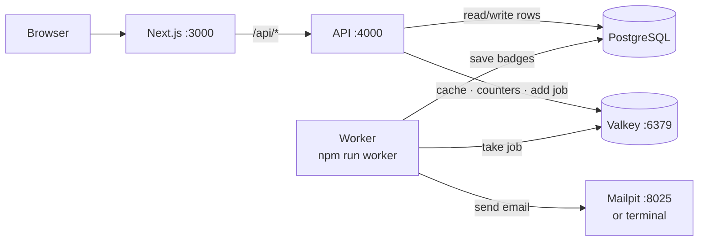
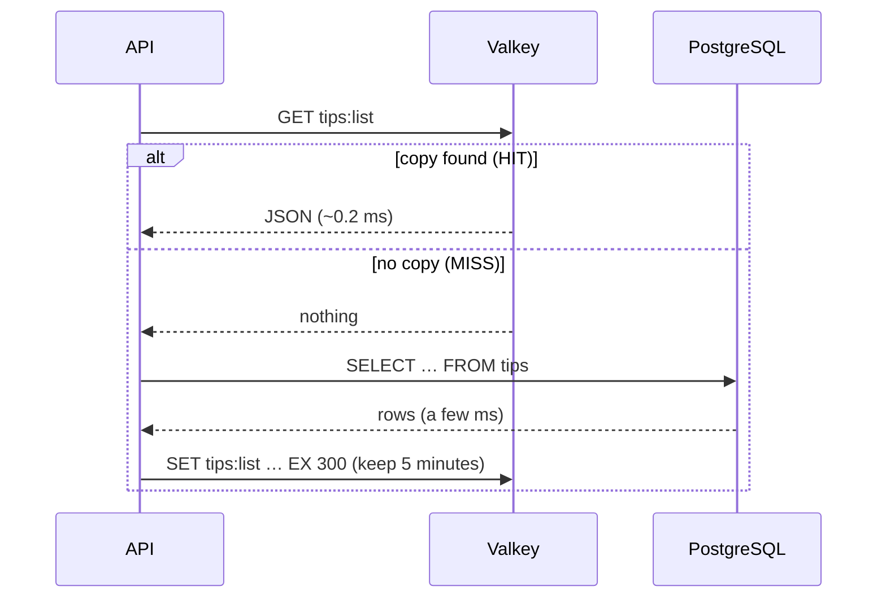
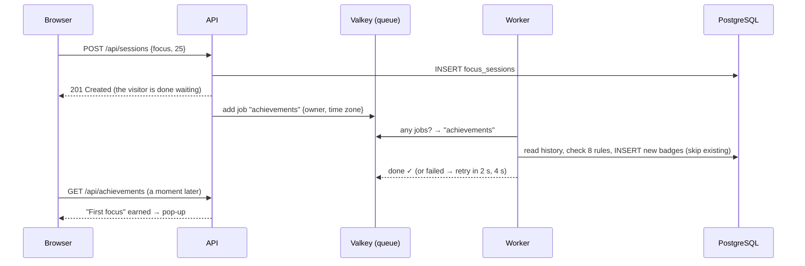

# Stage 5 — Valkey: cache, shared counters, a job queue and a worker

**Goal:** see why some work is done *later*, and how a cache makes reads fast.

New in MyWeb:
- **Achievements**: 8 badges, awarded by a **background worker** a moment after a focus session, with an "Achievement unlocked" pop-up
- **Welcome email** on sign-up, sent by the worker (printed in its terminal, or caught by **Mailpit**)
- **Cache**: tips and "who is this?" lookups come from Valkey, in well under a millisecond
- **Shared rate-limit counters** in Valkey, so several API servers can count together
- Also in this stage: an **app theme switch** (System / Light / Dark) and a **sound mixer with 11 generated tracks**

## 1. The system now



**Valkey** keeps data in memory (very fast) and is open source (BSD), a community fork of Redis.
It speaks the same protocol, so we use the standard Redis client library (`ioredis`).

## 2. Cache-aside (tips)



- Look for it yourself: DevTools → Network → `tips` → Response headers: **`X-Cache: MISS`**, then **`HIT`** on reload.
- **Expiry (TTL)**: every copy disappears after 5 minutes, so stale data fixes itself.
- **Invalidation**: when we change tips ourselves (`npm run db:seed`), we delete the copies right away.
  A test shows what happens if you skip it: an SQL change stays invisible until the copy expires.
- "No such tip" is cached too, so a wrong link can't hammer the database.

**"Who is this?" lookups** are cached for 60 seconds (`auth:session:<hash>`). Signing out deletes the copy, so a
signed-out cookie stops working **immediately**. The test "stops working right after sign-out" proves it.

## 3. Shared rate-limit counters

Stage 4 counted sign-in attempts in each API server's memory. With two API servers, an attacker would get
twice the attempts, and a restart reset the count. Now:

```
MULTI
  INCR    ratelimit:auth-email:email:alice@example.com     → 3   (same number on every server)
  PEXPIRE ratelimit:auth-email:email:alice@example.com 900000 NX   (start the 15-min window once)
  PTTL    …                                                 → time left, for Retry-After
EXEC
```

`INCR` is **atomic**: two servers adding 1 at the same moment always gives 2, never 1.

## 4. The job queue and the worker



**Why later?** The visitor shouldn't wait for work that isn't needed for the answer:
- Sending an email takes ~1 s and the mail server can fail. As a job, sign-up answers at once, and BullMQ **retries** (3 tries).
- Badge rules read your whole history. Fine now; slow with years of data. As a job, saving a session stays fast.
- Jobs are stored in Valkey, so they **survive a restart**, and you can run **several workers** (each job goes to exactly one).

**Safe to run twice:** if a job is retried, a badge must not be awarded twice. A unique index on
`(owner, code)` plus `ON CONFLICT DO NOTHING` makes the job *idempotent* (doing it twice = doing it once).

**How the browser hears about it:** after saving, it checks `/api/achievements` a few times (0.7 s, 1.5 s, 3 s, 6 s).
Stage 6 replaces this polling with a **live push over WebSockets**.

### The 8 badges

| Badge | How to earn it |
|---|---|
| First focus | 1 focus session |
| Getting into it | 5 sessions |
| Deep worker | 20 sessions |
| Full round | 4 sessions in one day |
| On a roll | 3 days in a row |
| Hundred minutes | 100 minutes in total |
| Early bird | a session before 7 am (your time zone) |
| Night owl | a session after 10 pm |

The browser sends its time zone (`X-Time-Zone: Asia/Ho_Chi_Minh`), so "before 7 am" means *your* 7 am.
Guest badges move into your account when you sign in (re-checked from the merged history).

## 5. When Valkey is down

Valkey is a **speed-up, not a requirement**. Tested by stopping it while MyWeb runs:

| Feature | Without Valkey |
|---|---|
| Tips | from PostgreSQL (`X-Cache: MISS` every time) |
| Sign-in lookups | from PostgreSQL |
| Rate limits | counted in each server's memory (like Stage 4) |
| Saving a session | ✓ works; the badge check is skipped and logged |
| Welcome email | skipped and logged |
| `/health` | `"valkey": "down (running without cache)"` |

It reconnects by itself ("Valkey connected again.").
Trade-off: a job that couldn't be queued is lost. That's fine for a badge, which is re-checked after the next session.
For must-not-lose work you'd write the job to PostgreSQL first (the "outbox" pattern).

## 6. Also in this stage

### Theme switch (System / Light / Dark)

The **"N" button** in development is **Next.js's own developer panel**. Its *Theme* option only changes that panel,
never MyWeb, and its dropdown is a plain browser `<select>`, which is why it looked rough.
MyWeb now has its **own** switch: in the sidebar on desktop, and a round button in the phone header (tap to cycle).

- Your choice is saved in `localStorage`. **System** follows your device, live, even if it changes while the page is open.
- A tiny script in `<head>` applies the theme **before the first paint**, so a dark page never flashes white.
- CSS reads `<html data-theme="dark">`; Tailwind's `dark:` classes follow it too (`@custom-variant` in `globals.css`).
- To hide the Next.js "N" button entirely in development, set `devIndicators: false` in `web/next.config.ts`.

### Sound mixer: 11 tracks, all generated

Every track is **composed by code** in `web/features/ambient/engine.ts` with the Web Audio API.
There are no audio files, so nothing to license or download.

| Music | Nature & noise |
|---|---|
| **Lo-fi beats**: swung drums, bass, jazzy 9th chords, vinyl crackle | **Rain**: plus heavier drops |
| **Lo-fi keys**: strummed chords, tape hiss | **Waves**: slow swell |
| **Night piano**: chords + a wandering pentatonic melody, reverb | **Fireplace**: roar, crackles, pops |
| **Music box**: bell arpeggios | **Forest**: wind and birds from left and right |
| **Ambient pad**: slow chords that cross-fade every 10 s | **Stream**: babbling water |
| | **Brown noise**: deep, steady, hides chatter |

- **Mix** any of them (rain + lo-fi beats + fireplace…). Each has its **own volume**, plus a master volume.
- How the music stays in time: a **look-ahead sequencer** schedules notes ~1 s ahead on the audio clock,
  so busy pages or background tabs don't make it stutter.
- How it sounds "real": drums are synthesised (a falling sine is a kick, a noise burst is a snare), piano notes
  are several harmonics fading at different speeds, bells use metallic "inharmonic" overtones, and a shared
  **reverb** (a convolver playing through 3 s of fading noise) adds a room.
- A browser test measures that every track actually makes sound, and keeps their loudness similar.

## 7. Run it

```bash
docker compose up -d                      # PostgreSQL + Valkey + Mailpit
cd api && npm run db:migrate              # adds the achievements table
npm run dev                               # terminal 1: API
npm run worker                            # terminal 2: worker (NEW)
cd web && npm run dev                     # terminal 3: website
```

- Emails: set `SMTP_URL=smtp://127.0.0.1:1025` in `api/.env`, then read them at **http://localhost:8025**.
- Look inside Valkey: `docker compose exec valkey valkey-cli` → `KEYS *`, `GET tips:list`, `TTL tips:list`.
- Tests: `cd api && npm test` (**42 tests**, using Valkey database 1) · `cd web && npm test` (**21 tests**).

## 8. Next: Stage 6

**Real-time with WebSockets:** the worker's "badge unlocked" reaches your browser instantly (no more polling),
and other people's activity can show up live, e.g. "3 people focusing right now".
