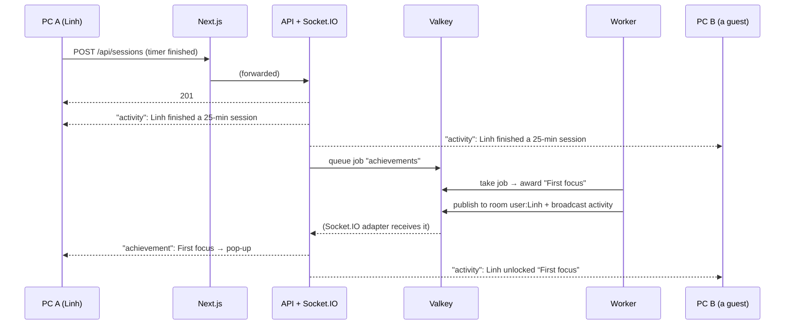
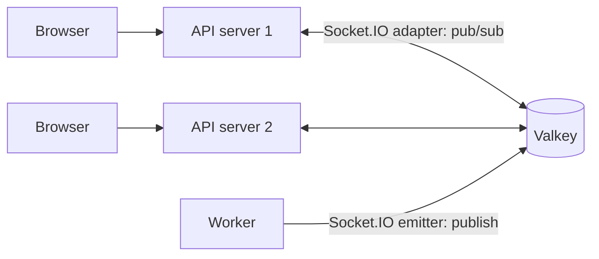

# Stage 6 — Real-time: live presence, a live feed, instant badges

**Goal:** see how one person's action reaches every other open browser instantly.

New in MyWeb:
- **Live now** card on Home: how many people are here and how many are focusing, plus a **live activity feed**
  ("Linh finished a 25-min focus session", "A guest unlocked “First focus”")
- A **"N focusing now"** pill on the timer and in the sidebar
- **Badges arrive instantly** (~0.2 s): the worker pushes them; no more asking every few seconds
- Also: **10 Vietnamese drill instrumentals** (original, generated in code)

## 1. Why HTTP isn't enough

HTTP is *ask → answer*. The server can't speak first, so in Stage 5 the browser asked "any new badges?"
4 times after each session ("polling"). A **real-time connection** stays open, so the server sends things
the moment they happen.

We use **Socket.IO**: it picks the best way to keep a connection open (**WebSocket**, or **HTTP long-polling**
as a fallback), reconnects by itself, and gives us *rooms* and *events*.

## 2. How an event travels



Measured in a browser test: **badge pop-up 231 ms** after saving, **other PC's feed 243 ms**.

### Events

| Direction | Event | Payload | Who gets it |
|---|---|---|---|
| browser → server | `focus:state` | `{ running, mode }` | (sets "focusing" for this tab) |
| server → browser | `presence` | `{ online, focusing }` | everyone |
| server → browser | `activity` | `{ icon, text, at }` | everyone |
| server → browser | `activity:recent` | last 20 activities | the tab that just connected |
| server → browser | `achievement` | `{ code, title, … }` | **only** the person who earned it (their *room*) |

### Rooms

Each connection joins one room for its owner: `user:<id>` when signed in, `client:<guest id>` otherwise.
All tabs and PCs of the same person share the room, so a badge pops up on **every** device you have open,
and nobody else's.

### Presence: people, not tabs

`online` counts **people** (rooms), so two tabs = one person. `focusing` = people with a running *focus* timer.
Many changes in a short time are bundled into one update (at most every 300 ms).

## 3. Many servers, one Valkey



- **Adapter** (`@socket.io/redis-adapter`): when server 1 sends to "everyone", Valkey forwards it to server 2,
  which sends it to its own browsers. `fetchSockets()` asks all servers who's connected, so presence counts everyone.
- **Emitter** (`@socket.io/redis-emitter`): the worker has no WebSocket server, but it can still publish events into Valkey.
- Tested: a browser on server 1 sees presence and activity from server 2, and the worker reaches a browser through Valkey.
- Without Valkey, real-time still works for the browsers on one server.
- **Gotcha (found by a failing test):** Valkey's publish/subscribe channels are shared by *all* its numbered databases.
  The tests use database 1, but they still heard the running dev server's events. Each setup now uses its own
  channel name (`myweb-socket.io` in dev, `myweb-test-socket.io` in tests), set from `QUEUE_NAME`.

## 4. Safety

- **Same-site only:** a socket is accepted only if the page's `Origin` matches the address the browser opened, like POST requests.
  This stops another website from opening a socket with your cookie ("cross-site WebSocket hijacking").
- **Who is it:** the server reads the same login cookie as HTTP, or the guest id. Without either, the connection is refused.
- **Never trust the browser:** `focus:state` is checked with Zod; junk is ignored (tested).
- **The feed shows first names only** ("Linh", or "A guest"); never emails. Everyone on the network sees it.
- **Icons in events are names** ("Timer"), mapped to known icons in the browser. The server never sends markup.

## 5. WebSocket vs long-polling (an honest finding)

Next.js's `/api/*` forwarding (`rewrites` in `next.config.ts`) passes normal HTTP requests, but **not WebSocket
"upgrade" requests** (tested: nothing reached the API). So in this stage the browser uses Socket.IO's
**HTTP long-polling**: it keeps one request open; the server answers it the instant something happens, then the
browser opens the next. Same events, same code, still fast (~0.2 s). Just a bit more overhead per message.

Two related fixes:
- Socket.IO normally adds a trailing slash (`/api/realtime/`), which Next.js redirects away, breaking the connection.
  Both sides now use `addTrailingSlash: false`.
- In **Stage 7, Caddy** sits in front and forwards WebSockets properly. Then switch the browser to
  `transports: ["websocket", "polling"]` in `features/realtime/RealtimeProvider.tsx`.
  With several API servers, long-polling also needs **sticky sessions** (the same browser always reaches the same server). Caddy can do that too.

## 6. The 10 Vietnamese drill instrumentals

Real Vietnamese drill songs are **copyrighted** recordings, so they can't be included (and downloads are blocked here).
Instead, `web/features/ambient/drill.ts` **composes 10 original instrumentals in the style**: no vocals, no samples,
no existing songs copied.

| # | Title | Meaning | Lead | BPM |
|---|---|---|---|---|
| 1 | Hẻm 2AM | The alley at 2 AM | đàn bầu | 142 |
| 2 | Mưa Trên Mái Tôn | Rain on a tin roof | đàn tranh | 140 |
| 3 | Sáo Nửa Đêm | Midnight flute | sáo trúc | 144 |
| 4 | Bến Cảng Khuya | The harbour, late | đàn bầu | 146 |
| 5 | Xe Ôm Cuối Ngày | Last motorbike ride of the day | đàn tranh | 143 |
| 6 | Đà Lạt Sương Dày | Thick fog in Đà Lạt | sáo trúc | 140 |
| 7 | Chợ Đêm Ánh Neon | Neon night market | đàn tranh | 145 |
| 8 | Sông Hàn 140 | The Hàn River at 140 BPM | bells | 140 |
| 9 | Gió Bấc Hà Nội | Hà Nội's north wind | sáo trúc | 142 |
| 10 | Ngã Tư Đèn Đỏ | The red-light crossroads | piano | 144 |

**What makes it drill:** 140–146 BPM; a **sliding 808** (a sine bass that glides between notes, slightly distorted);
the **snare on beat 3** with ghost snares (the "bounce"); **triplet hi-hat rolls** (3 hits in the space of 2); dark minor chords.

**What makes it Vietnamese:** melodies on pentatonic **điệu** (Oán, Bắc, and the sad hơi Ai), played by synthesised
traditional instruments:
- **Đàn bầu**: notes *slide* into pitch and a vibrato grows, like bending the rod of the one-string zither
- **Đàn tranh**: bright plucks that fade fast, with **"vê"** (fast repeated plucks) on long notes
- **Sáo trúc**: a breathy bamboo flute (a soft tone plus filtered breath noise)

**Each song is a song:** a fixed *seed* picks its melody, bass pattern and hi-hat rolls, so it's the same every time.
Structure: intro (4 bars, melody only) → drop (16 bars) → breakdown (4 bars) → drop with variations (16 bars), then it loops (~67 s).
Drill songs play **one at a time**; layer one with Rain or Fireplace if you like.

## 7. Run it

```bash
docker compose up -d
cd api && npm run dev        # API + real-time server (same port)
cd api && npm run worker     # background jobs: badges are pushed live
cd web && npm run build && npm start
```

Open MyWeb on two PCs (or two browsers), start the timer on one, and watch "1 focusing now" on the other.

Tests: `cd api && npm test` (**52**, incl. real sockets, long-polling, two servers sharing Valkey, the worker's emitter, and
refusing other websites) · `cd web && npm test` (**23**, incl. 10 drill songs).

## 8. Next: Stage 7

**Packaging with Docker Compose + Caddy:** the website, API, worker, database and Valkey all start with one command;
Caddy adds HTTPS and real WebSockets, and passes the visitor's real IP, so per-IP rate limits come back.
