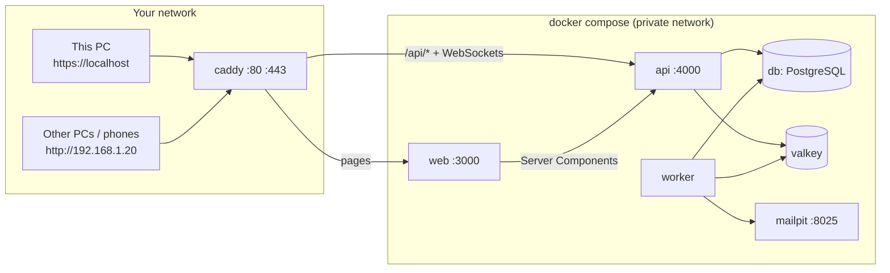
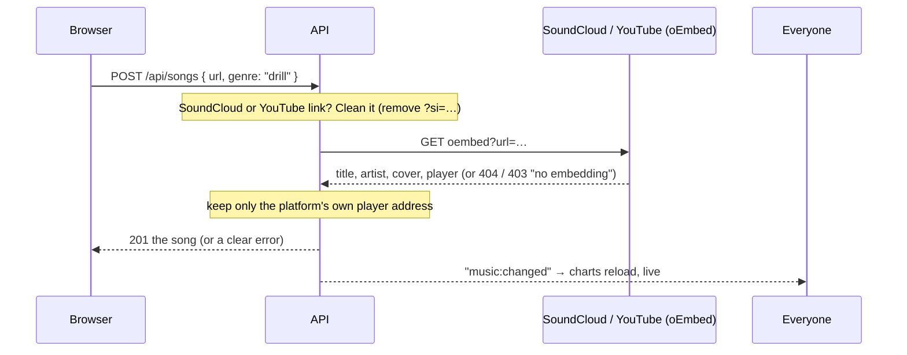

# Stage 7 — Packaging: Docker Compose + Caddy (plus Music and custom timer lengths)

**Goal:** start the whole system with one command, put a real front door (Caddy) in front of it,
and see how separate services find each other on one network.

Also in this stage:
- **Music**: songs **with vocals** (Drill, Remix, Pop, Lofi) from SoundCloud and YouTube, with
  **Top this week / this month / all time** charts. The generated Vietnamese drill instrumentals were removed.
- **Adjustable timer**: choose focus, short-break and long-break lengths, or a preset.

## 1. One command

```bash
cp .env.example .env                        # set a database password
docker compose --profile app up -d --build  # build and start everything
```

Then open **https://localhost** on this PC, or **http://&lt;this PC's IP&gt;** on other PCs and phones.



| Service | Image | Reachable from |
|---|---|---|
| `caddy` | `caddy:2.11` | **your network** (ports 80, 443) |
| `web` | built from `web/Dockerfile` | Caddy only |
| `api` | built from `api/Dockerfile` | Caddy and `web` only |
| `worker` | same image as `api`, runs `dist/worker.js` | nobody (it only calls out) |
| `db`, `valkey`, `mailpit` | official images | the other services; this PC on 127.0.0.1 |

Services find each other **by name** on Docker's private network: the API connects to `db:5432` and `valkey:6379`,
and Caddy forwards to `api:4000` and `web:3000`. Nothing but Caddy is open to your network.

`docker compose up -d` (without `--profile app`) still starts only the database, Valkey and Mailpit, for `npm run dev`.

## 2. The images

**API** (`api/Dockerfile`), in two steps: *build* compiles TypeScript; *run* copies only `dist/`, the SQL migrations
and production packages, and runs as a normal user (`USER node`), not root. On start it runs the migrations and the
seed, then the API. The worker uses the same image with another command.

**Website** (`web/Dockerfile`), in three steps (install → build → run). `output: "standalone"` in `next.config.ts` makes
Next.js copy only the files its server needs, so the image stays small.
Two values are fixed at build time: `API_URL=http://api:4000` and `NEXT_PUBLIC_REALTIME_WEBSOCKET=1`.

**Start order** comes from health checks: the API waits for a healthy database and Valkey; the worker and the website wait
for a healthy API (which has run the migrations).

## 3. Caddy: the front door

`Caddyfile`:

- `/api/*` → API (WebSockets included); everything else → website.
- **https://localhost** gets a certificate from Caddy's **own local certificate authority** (no internet needed);
  http://localhost redirects to it. The first time, your browser may warn you. To trust it, copy the root certificate
  out (`docker compose cp caddy:/data/caddy/pki/authorities/local/root.crt .`) and add it to your system's trusted certificates.
- Other PCs use **plain HTTP** on your network address (`:80` block). Installing that root certificate on every
  device would be needed for HTTPS there.
- **Real visitor IPs**: Caddy ignores any `X-Forwarded-For` a browser sends and sets the real one. The API trusts exactly one
  proxy hop (`TRUST_PROXY=1`), so `req.ip` is the visitor's address again, and **per-IP sign-in limits are back**
  (on top of per-email). Tested: a faked `X-Forwarded-For: 6.6.6.6` was ignored, and the real IP was counted.
- **Real WebSockets**: Caddy forwards WebSocket upgrades (tested: `101 Switching Protocols`), so browsers now use them
  instead of long-polling. If a network blocks them, Socket.IO falls back to polling (`tryAllTransports`).
- **Cookies**: the login cookie is marked `Secure` when you came over HTTPS (tested on https://localhost), and not on plain
  HTTP network addresses (where browsers would refuse it). The API learns which one from Caddy's `X-Forwarded-Proto`.

Tested without Docker (no Docker daemon in the sandbox): the production builds of the API, worker and website were run
exactly as the containers run them, behind a real Caddy built from source, on ports 80 and 443.
The Dockerfiles themselves still need a first `docker compose build` on your PC.

## 4. Music: songs with vocals, legally

Songs by artists are **copyrighted**, even when they're free to listen to on SoundCloud or YouTube. So Nook never
downloads or stores audio. It stores a **link**, and plays the song in the platform's **official embedded player**:
the artist keeps the rights and gets the plays, and a song whose owner turned embedding off simply can't be added.

### Adding a song



### Charts

`score = plays + 3 × likes` in the last **7 days** (This week), **30 days** (This month) or **all time**,
filterable by **Drill / Remix / Pop / Lofi**.
A play counts once per person per song per 10 minutes, so pressing play again and again can't push a song up.
Charts **re-sort live** for everyone when anyone plays, likes or adds a song (tested: a like moved a song from #4 to #2
on another PC within 2 seconds).

**Why not SoundCloud's own top charts?** SoundCloud has no public charts service to read from, and copying its pages
would break its terms. Nook's charts are made by its own listeners instead.

### Playing

The player dock (bottom-right on desktop, above the tab bar on phones) keeps playing while you move between pages,
shows next / previous / open-on-SoundCloud, and uses the platforms' **official player scripts** only to notice when a song
ends and start the next one.

## 5. Adjustable timer

**Times** on the timer card: presets (**Classic** 25/5/15, **Quick** 15/3/10, **Deep** 50/10/30, **Flow** 90/20/30) or
set each length (focus 1–120 min, breaks 1–60). Changing it mid-session keeps the current session as it is;
the new length starts with the next one. It's saved on the device, and **in your account when signed in**:
tested, a 50-minute focus chosen on one PC showed up on another after signing in there.

## 6. API endpoints added

| Method | Path | |
|---|---|---|
| GET | `/api/songs?period=week\|month\|all&genre=…` | charts |
| POST | `/api/songs` | add a song (10 per hour per person) |
| POST | `/api/songs/:id/play` | count a play |
| PUT / DELETE | `/api/songs/:id/like` | like / unlike |
| PUT | `/api/me/preferences` | save timer lengths to your account |

Tests: `cd api && npm test`: **63** (incl. a fake SoundCloud/YouTube, charts, plays, likes, preferences) ·
`cd web && npm test`: **24**.

## 7. Next: Stage 8

**Automation and monitoring:** GitHub Actions runs the tests and builds the images on every push; OpenTelemetry and
Grafana show how a request travels through Caddy, the website, the API, the database and Valkey.
