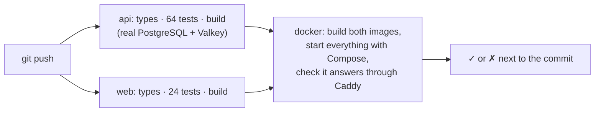
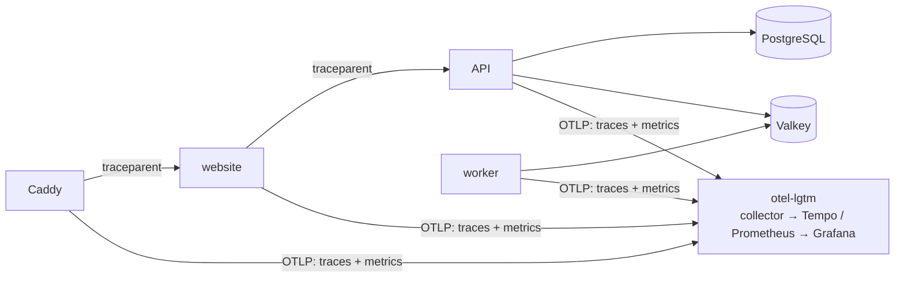
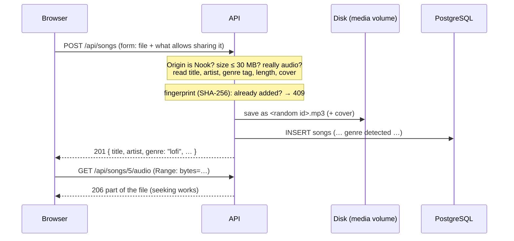

# Stage 8 — Automation and monitoring (and Music that works everywhere)

**Goal:** see how code gets tested on every push, and how to trace one request through every service.

Also in this stage, **Music was rebuilt** after real-world testing showed three problems:

| Problem (Stage 7) | Fix (Stage 8) |
|---|---|
| SoundCloud / YouTube players are blocked by some firewalls (offices, schools) | Nook **stores the song files and plays them itself**: if you can open Nook, you can play its songs |
| Many YouTube videos refuse to play on other sites and open the YouTube app | No YouTube player any more: a plain `<audio>` player, with lock-screen controls on phones |
| Charts started empty, and you had to choose a genre | A **starter pack of 12 Creative Commons songs with vocals**, and **genre detected automatically** |

## 1. GitHub Actions: tested on every push

`.github/workflows/ci.yml` runs on GitHub's machines for every push and pull request:



- **api** and **web** run in parallel; **docker** only runs when both pass.
- The **docker** job is the first real test of the Dockerfiles (there's no Docker in the development sandbox): it builds the images,
  starts PostgreSQL, Valkey, API, worker, website and Caddy, waits for the health checks, then requests pages and API data **through Caddy**
  over HTTPS and plain HTTP. If anything fails, it prints the containers' logs.
- A newer push to the same branch cancels the older run (`concurrency`).
- See the results in the **Actions** tab of the repository.

## 2. OpenTelemetry + Grafana: one request, every service

```bash
# in .env, uncomment the three monitoring lines (see .env.example), then:
docker compose --profile app --profile monitoring up -d --build
```

Open **Grafana at http://localhost:3001**. The `otel-lgtm` container is Grafana's all-in-one OpenTelemetry image:
a collector, **Prometheus** (metrics), **Tempo** (traces), Loki (logs) and Grafana.



### Traces

Every service adds its part to the same **trace**, linked by the `traceparent` header that each one passes on:

```
caddy                        GET /chill/tips
└─ nook-web                 render route (app) /chill/tips
   ├─ fetch GET http://api:4000/api/auth/me
   │  └─ nook-api           GET /api/auth/me
   │     └─ valkey           get auth:session:…
   └─ fetch GET http://api:4000/api/tips
      └─ nook-api           GET /api/tips
         ├─ valkey           get tips:list        (miss)
         └─ postgres         SELECT … FROM tips
```

In Grafana: **Explore → Tempo → Search**, pick service `nook-web`, open a trace.

**How:** `api/src/telemetry.ts` is loaded *before* the app (`node --import ./dist/telemetry.js dist/index.js`) so it can wrap
HTTP, Express, PostgreSQL, Valkey and Socket.IO automatically. Because our code uses ES modules, it registers OpenTelemetry's
module hook first. The website uses Next.js's built-in support (`web/instrumentation.ts`, `@vercel/otel`), and only passes
trace headers to *our* API. Caddy's `tracing` directive starts the trace.
Tested without Docker: one page request produced **one trace with spans from both the website and the API** (pages, fetches,
Express routes, PostgreSQL queries, Valkey commands).

Everything is **off unless `OTEL_EXPORTER_OTLP_ENDPOINT` is set**, so without the monitoring profile nothing changes.

### Metrics

Automatic: request counts and durations per route (`http.server.request.duration`). Nook's own (`api/src/metrics.ts`):

| Metric (Prometheus name) | Meaning |
|---|---|
| `nook_focus_sessions_total` | focus sessions saved |
| `nook_song_plays_total`, `nook_song_uploads_total` | Music activity |
| `nook_cache_lookups_total{result="hit\|miss"}` | how often Valkey had the answer |
| `nook_jobs_total{job_name, status}`, `nook_job_duration_seconds` | background worker |
| `nook_realtime_connections` | open live connections right now |

**Dashboard:** Grafana → Dashboards → New → **Import** → upload `monitoring/grafana-dashboard.json` → pick the Prometheus data source.
It shows requests per route, response time (95th percentile), errors, cache hit rate, jobs, focus sessions, song plays and live connections.

## 3. Music, rebuilt

### Songs are files Nook stores



- **No genre to choose:** it's read from the file's genre tag ("Hip-Hop" → Drill, "Dance" → Remix, "Chillout" → Lofi), else guessed from
  the title ("(Vinahouse Remix)", "Lofi Ver.", "slowed + reverb"), else Pop. The person who added a song can still change it in the chart.
- **Only songs you may share:** the upload asks what allows it (*I made them* / *a free licence*, with licence and credit /
  *I have permission*) and a confirmation. Nook shows the licence and credit with every song.
- **Plays anywhere Nook opens:** files stream from Nook itself, with HTTP Range requests (seeking) and long browser caching.
  The player keeps playing between pages, moves to the next song, and shows on phones' lock screens (Media Session).
- **Safety:** uploads must come from Nook's own page (the Origin header is required for forms), files are checked to really be audio,
  stored under random names, and the file's location on disk is never sent to browsers.

### The starter pack: 12 Creative Commons songs with vocals

Chosen from **ccMixter** by listener ratings, 3 per genre, all with singing or rapping, under licences that allow sharing them here
(CC BY / CC BY-NC, non-commercial with credit):

| Genre | Songs |
|---|---|
| Drill / rap | *Go time*, *Demons got ahold of me* (FORENSIC) · *It's Only Me* (Donnie Ozone) |
| Remix | *Outside Poolside* (Lasswell) · *Broken (DURDEN version)* (DURDEN feat. Amelia June) · *A Scene Before Fire* (Jeris) |
| Pop | *I Wonder If God Was Sleeping* (Scott Altham) · *too quiet* (oldDog feat. narva9) · *Unsaid* (7OOP3D) |
| Lofi / chill | *Brilliant Daze* (Pat Chilla The Beat Gorilla) · *Babylon Bring Me Down* (spinningmerkaba) · *ophelia's next goodbye* (audiomesh) |

**Why you download them yourself:** ccMixter only allows downloads from its own pages (direct file requests get "403 Forbidden"),
so Nook doesn't fetch them behind its back. On **Music → Add songs**, each one links to its ccMixter page:

1. Open each page, press **Download**.
2. Either drop the 12 files on the Add songs page, or put them in `music-import/` and run
   `docker compose exec api node dist/music/import.js /import` (without Docker: `cd api && npm run music:import -- ../music-import`).

Nook recognises them **by file name** and fills in title, artist, genre, licence, credit and source.
Vietnamese songs with vocals under free licences are rare; for Vietnamese drill, remix, pop or lofi, upload songs you have the right to share.

## 4. API changes

| Method | Path | |
|---|---|---|
| POST | `/api/songs` | upload one song (multipart form) |
| GET | `/api/songs/:id/audio` | the file, with seeking |
| GET | `/api/songs/:id/artwork` | its cover, if any |
| PATCH / DELETE | `/api/songs/:id` | fix genre / title / artist, or remove (whoever added it) |

Migrations `0005` + `0006`: the songs table holds files now. Songs that were only SoundCloud/YouTube links are removed (with their plays and likes).

## 5. Next: Stage 9

**Local AI with Ollama (optional):** a small open model on your own PC suggests what to watch, read or play, and answers from Nook's own data.
