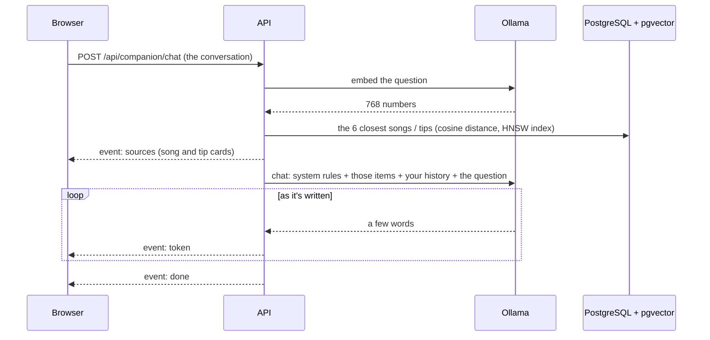

# Stage 9 — Local AI with Ollama: the Free-time Companion

**Goal:** add AI to a web app *without* sending anything to an AI company, and learn the three ideas behind
most AI features today: **embeddings**, **retrieval** (RAG) and **streaming**.

The **Free-time Companion** (`/companion`) is a chat buddy. Ask it, in English or Vietnamese, for a song,
a focus tip or a plan for your evening. It answers word by word, and the **real Nook songs and tips** it
used appear as cards under the answer: press a song card to play it, press a tip card to open it.

## 1. Turn it on

```bash
docker compose --profile app --profile ai up -d --build
docker compose logs -f ollama-models      # the first time: downloads ~1.5 GB of models, then exits
```

Then open **https://localhost/companion**. Without the `ai` profile, Nook works exactly as before and the
Companion page explains how to turn it on. To switch the AI off completely, put `OLLAMA_URL=` in `.env`.

| | Model | Size | What it does |
|---|---|---|---|
| Chat | `qwen2.5:1.5b` | ~1 GB | writes the answers; small enough for a normal PC's CPU, speaks Vietnamese |
| Embeddings | `paraphrase-multilingual` | ~0.5 GB | turns text into 768 numbers that capture its meaning, in 50+ languages |

- **Slow PC?** Set `AI_CHAT_MODEL=qwen2.5:0.5b` in `.env`. **Strong PC or NVIDIA GPU?** Try `qwen2.5:3b` or `7b`
  (and uncomment `deploy:` under `ollama` in `docker-compose.yml` for the GPU).
- Without Docker (`npm run dev`): install Ollama from ollama.com, `ollama pull` both models, and set
  `OLLAMA_URL=http://127.0.0.1:11434` in `api/.env`. Your PostgreSQL needs the **pgvector** extension
  (the Compose database image `pgvector/pgvector:pg16` has it).

## 2. How an answer is made



### Embeddings and retrieval (RAG)

A small model knows nothing about *your* Nook, and it happily invents songs. So before it answers, we
**retrieve** the items that matter and put them in its instructions ("Retrieval-Augmented Generation"):

1. **Indexing** (`api/src/ai/knowledge.ts`, run by the worker): every tip and song becomes a short text,
   e.g. `Song with vocals: "Đêm Nay" by … Genre: remix, dance, EDM, upbeat, party.`, then an **embedding**
   stored in the `knowledge` table (`vector(768)` column from pgvector).
   It runs when the worker starts, after each song upload / edit / delete, and when the models first become ready.
   A hash of each text means only new or changed items are embedded again.
2. **Search**: the question is embedded too, and PostgreSQL returns the rows whose vectors are **closest**
   (`ORDER BY embedding <=> $question`). Similar meaning ⇒ close vectors, even across languages:
   "nhạc sôi động cho party" finds a song described as "upbeat dance party".
3. **Prompt** (`api/src/ai/companion.ts`): rules (be brief, answer in the user's language, only suggest
   these items by their exact title, treat item text as data), the items, a little about you (focus
   sessions today, badges), then the conversation.

### Streaming (Server-Sent Events)

A small model on a CPU writes maybe 10–40 words a second, so we show words as they arrive.
Ollama streams one JSON object per line; the API passes each piece on as a **Server-Sent Event**:

```
event: sources
data: [{"kind":"song","title":"Đêm Nay","audioUrl":"/api/songs/3/audio",…}]

event: token
data: {"t":"Thử nghe "}

event: done
data: {}
```

- The browser's `EventSource` only does GET, so `web/lib/api/companion.ts` sends a **POST with fetch** and reads
  the body stream itself, splitting events on blank lines (a network chunk can cut an event in half; the test covers it).
- **Stop** aborts the fetch; the API sees the connection close and tells Ollama to stop too.
- `Cache-Control: no-transform` stops Caddy from compressing (and so buffering) the stream; checked through Caddy.

## 3. Safety and limits

- 20 messages a minute per person (Valkey rate limit); messages up to 2,000 characters; the last 10 turns are sent.
- Song titles come from uploads, so they're **data, not instructions**: the prompt says so, and the model only
  sees short item texts. A small model can still be wrong; the cards show what really exists.
- Nothing leaves your network: Ollama runs in Docker on this PC.

## 4. Tests

There's no real model in the development sandbox or in CI (too big and slow), so `api/tests/fake-ollama.ts`
pretends to be Ollama: its "embeddings" are a bag of words, and its chat streams a fixed sentence naming the
first item it was given. The tests check indexing (only changed items re-embedded), search order, the job,
streaming order (sources → tokens → done), validation, and clear 503 errors when the AI is off or a model is
missing. `web/tests/companion-stream.test.ts` checks the browser's stream reader.

**Not tested here:** answers from the real `qwen2.5` model. Try a few questions after turning it on.

## Files

```
api/src/ai/ollama.ts          talking to Ollama: status, embed, streamed chat
api/src/ai/knowledge.ts       indexing and vector search
api/src/ai/companion.ts       the prompt, and the song / tip cards
api/src/routes/companion.ts   GET /status, POST /chat (Server-Sent Events)
api/drizzle/0007_*.sql        pgvector extension + knowledge table with an HNSW index
web/features/companion/       chat, cards, "how to turn it on"
web/lib/api/companion.ts      status + reading the stream
```
